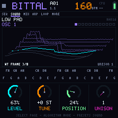
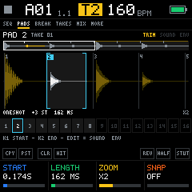

<b>Firmware libre de groovebox hi-fi de 6 máquinas para el M-VAVE FM-1.</b> 
Batería, sampler de pads, bajo, FM, wavetable y polifónico, calculados en vivo a 44,1 kHz y 24 bits. Escrito desde cero en C99. Licencia GPL-3.0.

<a href="https://erbubar23.github.io/bubba-machine/">Sitio web</a> ·
<a href="https://erbubar23.github.io/bubba-machine/emulador.html">Probar en el navegador</a> ·
<a href="docs/MANUAL.md">Manual</a> ·
<a href="CHANGELOG.md">Cambios</a> ·
<a href="https://erbubar23.github.io/bubba-machine/en/">English</a>

---

> **Estado: 0.9.0-beta.** Corre en el aparato y se instala desde el navegador, plug and play, pero es una **beta**: se probó en un solo FM-1 y todavía cambia mucho (la 0.9.0-beta, todavía sin probar del todo en el aparato). **Una actualización puede borrar lo que guardaste** (patrones, canción, ajustes y tomas): hasta la v1 no hay compatibilidad hacia atrás. Ver [cómo instalar](docs/INSTALAR.md) y [cómo volver al firmware de fábrica](docs/INSTALAR.md#volver-al-firmware-de-fábrica).

## El objetivo: una máquina hi-fi

Bubba Machine busca **el mejor sonido que puede dar el hardware del FM-1**, sin atajos que se oigan:

- **44,1 kHz y 24 bits de punta a punta:** todas las máquinas y la mezcla corren a la frecuencia real del códec, en coma flotante. Los agudos llegan a 20 kHz.
- **Todo se calcula en vivo:** nada de grabaciones de 8 bits ni tablas de baja resolución.
- **El circuito real antes que un preset:** cada máquina tiene su propio motor modelado sobre la que la inspira (el BB-303 usa el filtro y el acento de la TB-303 de Open303) y sonidos históricos recreados a partir de hojas de patches.
- **Todo el hardware trabajando:** los dos núcleos de 360 MHz (TWO CORES), sidechain para que el kick atraviese la mezcla y los voltajes de fábrica de la placa para que no se apague.
- **Medido, no adivinado:** cada cambio se mide en el aparato y en horas de juego simulado. Ver [la calidad de audio](docs/en/AUDIO.md).

## Qué es

Bubba Machine convierte el FM-1 en una groovebox de directo con **seis canales**, **cuatro gestos por botón y HOME en todas partes**:

- **T1 BR-8, batería estilo TR:** 16 instrumentos con su propia línea y su propio largo (polímetro), acento, repetición, flam, P-Locks y pasos que solo suenan en el fill. Roll y borrado estilo TR mientras suena.
- **T2 BP-1, sampler de pads:** 16 pads hechos con tus tomas, como un KO II o un OP-1 field. Cada pad tiene su inicio, su largo, su tono y su modo de tecla (sostenido puede seguir por la toma). Una rejilla como la de la batería los toca y BREAK la varía compás a compás. Grabadora propia y biblioteca de tomas.
- **Pantalla en inglés**, para que se entienda en todo el mundo, con el español como paquete de idioma que se carga aparte ([cómo](docs/MANUAL.md#idioma-de-la-pantalla)).
- **T3-T6 eligen su máquina:** **BB-303** (bajo ácido sobre Open303), **B-MINI** (tres osciladores con filtro escalera), **BX-7** (FM de 6 operadores, lee bancos .syx de la DX7), **BITTAL** (wavetable que carga presets de Vital) y **BUNO-6** (polifónico con chorus). Banco de 92 sonidos, muchos históricos, y un [editor web](https://erbubar23.github.io/bubba-machine/sonidos.html) para sumar los tuyos. Arpegiador, loopera, escala propia y MIDI OUT por canal.
- **HOME es la consola BX-1:** 10 patrones, los seis canales, mutes, solo, escenas y CUE en las teclas, y la mezcla y los efectos de cada canal. REC en la consola graba cualquier canal sin entrar (estilo SLOOP).
- **REC expresivo:** cada nota guarda su micro-tiempo, su largo y lo que moviste mientras la tocabas.
- **Tiempo por pista:** cada pista tiene su largo (1-64) y su velocidad (×2 a ×1/4).
- **Acordes en cuadrícula:** 16 acordes con su grado y su función por color.
- **Directo:** 4 escenas de mutes con cadenas, CUE, grabación de la canción, fills automáticos, 16 efectos punch-in y mutes por pista e instrumento que se mantienen al cambiar de patrón.
- **Guardado seguro** en flash (CRC, commit al final, wear-leveling y autoguardado al parar), MIDI IN, reloj externo y Split Sync.

## Pruébalo

Abre el [emulador web](https://erbubar23.github.io/bubba-machine/emulador.html) en Chrome o Edge y pulsa *Encender*. Arranca con una demo; la barra espaciadora es PLAY. También funciona sin internet: abre `web/emulador.html` desde tu copia del repo.

## Documentación

| | |
|---|---|
| [Manual](docs/MANUAL.md) | Cómo se toca, botón por botón |
| [Instalar](docs/INSTALAR.md) | El instalador web, plug and play, y cómo volver al de fábrica |
| [Control](https://erbubar23.github.io/bubba-machine/control.html) | Con el FM-1 conectado: memoria, tomas, sonidos de Vital y DX7, idioma |
| [Desarrollo](docs/DESARROLLO.md) | Compilar, probar, generar los sonidos y el sitio |
| [Hoja de ruta](docs/HOJA_DE_RUTA.md) | Todo lo contemplado, de audio y de interfaz |
| [Diseño 0.6](docs/DISENO_0.6.md) | Las seis máquinas, la cara nueva y el banco de sonidos |
| [Diseño 3.0](docs/DISENO_3.0.md) | Por qué la interfaz es así: cuatro gestos por botón y HOME en todas partes |
| [Audio](docs/AUDIO.md) | Calidad de audio: qué se mejoró, cuánto cuesta en el FM-1 y qué falta |
| [Especificación](docs/SPEC_V3.md) | Hardware, memoria, audio y decisiones técnicas |
| [Cambios](CHANGELOG.md) | Qué trae cada versión |
| [Contribuir](CONTRIBUTING.md) | Cómo ayudar y qué reglas seguimos |
| [Créditos](CREDITOS.md) | Agradecimientos, terceros y marcas |

## Licencia

Bubba Machine es **software libre** bajo la [GNU General Public License v3.0 o posterior](LICENSE) (`GPL-3.0-or-later`). Puedes usarlo, estudiarlo, modificarlo y compartirlo; si distribuyes una versión modificada, tiene que seguir siendo libre y con su código fuente.

- **Todo el código es propio**, escrito desde cero. De la ingeniería inversa pública del FM-1 solo se usaron hechos de hardware (pines, tiempos, mapa de memoria). Ver [créditos](CREDITOS.md).
- **Los sonidos se calculan en vivo** (Plaits, msfa y modelos propios); el firmware no lleva audio grabado de terceros. Los sonidos de fábrica de B-MINI y BITTAL salen de presets de Vital de la comunidad con licencia libre (CC0, Unlicense y GPL-3.0), con su crédito en [CREDITOS.md](CREDITOS.md).

M-VAVE y FM-1 son marcas de sus respectivos dueños. Este proyecto no está afiliado a M-VAVE ni respaldado por ellos. Instalar firmware no oficial puede dejar tu aparato inservible: hazlo bajo tu propio riesgo y solo cuando exista una versión probada.

---

## In English

**Bubba Machine** is a free (GPL-3.0-or-later) **hi-fi** groovebox firmware for the M-VAVE FM-1: BR-8 modeled drums, BP-1 pad sampler, and on T3-T6 your choice of BB-303 acid bass (after Open303), B-MINI, BX-7 FM (reads DX7 .syx banks), BITTAL wavetable (loads Vital presets) and BUNO-6 polysynth with chorus, plus the BX-1 console on HOME. Written from scratch in C99.

- **The goal is hi-fi:** the best sound the FM-1's hardware can give. Every machine and the mix run at 44.1 kHz / 24-bit in floating point, everything is computed live (no low-res samples), each machine has its own engine modeled on the real one, and both 360 MHz cores can share the work (TWO CORES). Every change is measured on the device ([audio quality](docs/en/AUDIO.md)).

- **Status:** 0.9.0-beta. It runs on the device and installs from the browser, plug and play, but it is a **beta**: tested on a single FM-1 and still changing a lot (0.9.0-beta, not fully tried on the device yet). **An update may erase what you saved** (patterns, song, settings and takes): there is no backward compatibility until v1. You can also try it in the [web emulator](https://erbubar23.github.io/bubba-machine/emulador.html).
- **Website and docs in English:** [erbubar23.github.io/bubba-machine/en](https://erbubar23.github.io/bubba-machine/en/), with the [manual](docs/en/MANUAL.md), [install status](docs/en/INSTALL.md), [audio quality](docs/en/AUDIO.md) and [roadmap](docs/en/ROADMAP.md). The firmware screens are in English; Spanish is an optional language pack. Issues and pull requests in English are welcome.
- **Clean room:** all project code is original; synthesis libraries (Plaits, msfa, Open303) and the community Vital presets in the factory bank keep their free licenses ([credits](docs/en/CREDITS.md)). Only hardware facts from public FM-1 reverse engineering were used.
- M-VAVE and FM-1 are trademarks of their respective owners. This project is not affiliated with or endorsed by M-VAVE.
