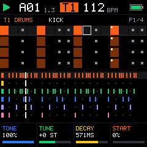
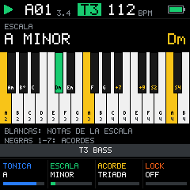
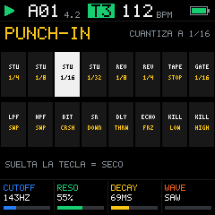
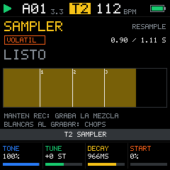

<p align="center"></p>

<p align="center"><b>Firmware de groovebox de 6 pistas para el M-VAVE FM-1.</b><br>
Diseño propio, escrito desde cero en C99.</p>

<p align="center">




</p>

---

## Estado (0.1.0)

| Parte | Estado |
|---|---|
| Núcleo (audio, secuenciador, UI, guardado) | **Completo y probado en PC**: 261 comprobaciones automáticas en verde |
| Emulador web (WebAssembly) | **Funciona**: el mismo código C, probado en Chromium |
| Port al FM-1 | **Esqueleto**: estructura, pines y escaneo de matriz probados; los drivers de registros están marcados `TODO(HW-VERIFY)`. **Aún no se ha flasheado ni probado en un FM-1.** Ver [`hal/fm1/README_PORT.md`](hal/fm1/README_PORT.md) |

## Pruébalo ahora

Abre **`web/index.html`** en Chrome o Edge (doble clic sirve) y pulsa *Encender*. Arranca con una demo. Dale PLAY con la barra espaciadora.

## Qué hace

- **6 pistas**: T1 batería (ROMpler con 2 kits sintetizados y choke de hi-hats), T2 sampler (resample de la mezcla, chops en vivo), T3 bajo mono con glide, T4-T6 synths de wavetable con filtro SVF.
- **Secuenciador** de 64 pasos (4 páginas), 4 eventos por paso, **P-Locks** de 4 macros, probabilidad, TIE/glide, swing de 50 a 75 %, FILL, copiar/pegar/borrar y deshacer.
- **16 patrones** que cambian al final del compás, **song mode**, mute/solo en vivo.
- **Escala y acordes** en las teclas, con el teclado real (F3-G5) dibujado en pantalla. **Arpegiador** en vivo.
- **16 punch-in FX** (stutter, reverse, tape stop, gate, sweeps, bitcrush, delay throw, freeze...), **delay** a tempo, **sidechain** automático del bombo, **soft-clipper** con drive.
- **Guardado seguro** en flash: log circular con CRC y commit al final (sobrevive cortes de energía), wear-leveling, autoguardado en STOP.
- **MIDI** IN (canales 1-6 = pistas, reloj externo), reloj de salida, **Split Sync** para Pocket Operator y Volca.

El manual está en [`docs/MANUAL.md`](docs/MANUAL.md) y la especificación técnica en [`docs/SPEC_V3.md`](docs/SPEC_V3.md).

## Cómo se toca, en corto

| Gesto | Qué hace |
|---|---|
| **Toque corto** en un botón | Abre su pantalla |
| **Mantener** (300 ms) | Su capa en vivo: SEQ = patrones · HOME = mute · FX = punch-in · SCL = acordes · ARP = arpegio |
| **GLO +** algo | Global: KNOB 1-4 = BPM, swing, largo, drive · SEQ = song · OCT = transponer |
| **ALGORITHM** / **PRESETS** | Cambian de pista / de patrón |
| En SEQ: **mantener un paso + girar** | P-Lock (KNOB 1-4), nota (SELECT), probabilidad (ALGORITHM), largo (PRESETS) |

## Compilar y probar

Todo corre en Docker (no hace falta compilador local). Requiere Python 3 con `numpy` y `Pillow` para los assets.

```sh
py -3 tools/build.py assets   # fuente, sonidos, ondas y logo
py -3 tools/build.py test     # pruebas en PC + capturas en assets/screens/
py -3 tools/build.py web      # emulador: web/bm.js
py -3 tools/build.py all
```

## Estructura

```
core/        el firmware (C99 puro, sin hardware): audio, secuenciador, UI, guardado
core/gen/    datos generados: fuente, kits, ondas, logo de arranque
hal/         capas de hardware: sim (PC/web), web (WebAssembly), fm1 (port)
web/         emulador en el navegador
tests/       pruebas automáticas
tools/       generadores de assets y build
docs/        especificación, manual, presupuesto de memoria
assets/      logo y capturas de pantalla
```

## Origen y licencias

- **Todo el código es nuevo** y no contiene código de Felucca, SLOOP ni Bubba Box. De la ingeniería inversa pública del FM-1 solo se usaron **hechos de hardware** (pines, tiempos, mapa de memoria), documentados con su fuente en `docs/SPEC_V3.md` §11.
- **Sonidos**: los dos kits se **sintetizan** en `tools/gen_assets.py` y las 16 ondas se generan por síntesis aditiva. No incluye samples de terceros. Se pueden cargar ondas AKWF (CC0) con `--akwf`.
- **Fuentes de pantalla** dibujadas a mano en `tools/gen_font.py`.
- **Logo**: el sol de Bubba Box, rediseñado para Machine (dientes de engranaje en vez de rayos).
- **Licencia del proyecto: pendiente** (decisión 1b de la spec). Al no reutilizar código GPL, puede ser la que elijas.

M-VAVE y FM-1 son marcas de sus dueños; este proyecto no está afiliado a ellos. Instalar firmware no oficial es bajo tu propio riesgo.
