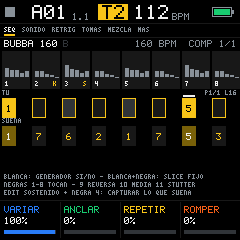
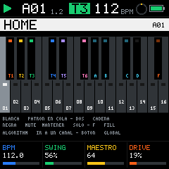
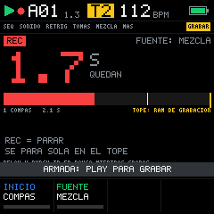
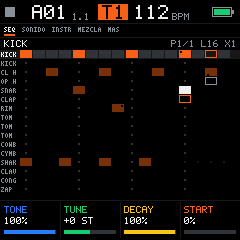

<b>Firmware libre de groovebox de 6 pistas para el M-VAVE FM-1.</b> 
Batería TR, sampler, bajo y 3 synths. Escrito desde cero en C99. Licencia GPL-3.0.

<a href="https://erbubar23.github.io/bubba-machine/">Sitio web</a> ·
<a href="https://erbubar23.github.io/bubba-machine/emulador.html">Probar en el navegador</a> ·
<a href="docs/MANUAL.md">Manual</a> ·
<a href="CHANGELOG.md">Cambios</a> ·
<a href="https://erbubar23.github.io/bubba-machine/en/">English</a>

---

> **Estado: 0.3.0, vista previa con la interfaz 3.0.** Todo el firmware corre y se prueba en PC y en el emulador web. La 0.3 no lee lo que guardó la 0.2. **El port al FM-1 todavía no se ha probado en un aparato real y no hay instalador.** No intentes flashearlo aún. Ver [cómo instalar](docs/INSTALAR.md).

## Qué es

Bubba Machine convierte el FM-1 en una groovebox de directo con **cuatro gestos por botón y HOME en todas partes**:

- **T1 Batería estilo TR:** 16 instrumentos con su propia línea y su propio largo (polímetro), acento, repetición, flam, P-Locks y pasos que solo suenan en el fill. Roll y borrado estilo TR mientras suena.
- **T2 Sampler 3.0:** un loop en 8 slices que un generador rearma compás a compás. La fila TU es lo que programas y la fila SUENA, lo que eligió. Grabadora propia, biblioteca de tomas y editor para cortar. Dibuja el sample por frecuencias (graves, medios y agudos).
- **T3 Bajo** de wavetable con glide, y **T4-T6 libres:** SYNTH, MONO, KIT (otra batería) o MIDI. Arpegiador, loopera y escala propia por canal.
- **Tiempo por pista:** cada pista tiene su largo (1-64) y su velocidad (×2 a ×1/4).
- **Acordes en cuadrícula:** 16 acordes con su grado y su función por color.
- **Directo:** 4 escenas con cadenas y grabación de la canción, fills automáticos, 16 efectos punch-in y mutes por pista e instrumento.
- **Guardado seguro** en flash (CRC, commit al final, wear-leveling y autoguardado al parar), MIDI IN, reloj externo y Split Sync.

## Pruébalo

Abre el [emulador web](https://erbubar23.github.io/bubba-machine/emulador.html) en Chrome o Edge y pulsa *Encender*. Arranca con una demo; la barra espaciadora es PLAY. También funciona sin internet: abre `web/emulador.html` desde tu copia del repo.

## Documentación

| | |
|---|---|
| [Manual](docs/MANUAL.md) | Cómo se toca, botón por botón |
| [Instalar](docs/INSTALAR.md) | Estado del instalador y cómo será la instalación |
| [Desarrollo](docs/DESARROLLO.md) | Compilar, probar, generar los sonidos y el sitio |
| [Hoja de ruta](docs/HOJA_DE_RUTA.md) | Qué viene: el port al FM-1 y el instalador |
| [Diseño 3.0](docs/DISENO_3.0.md) | Por qué la interfaz es así: cuatro gestos por botón y HOME en todas partes |
| [Especificación](docs/SPEC_V3.md) | Hardware, memoria, audio y decisiones técnicas |
| [Cambios](CHANGELOG.md) | Qué trae cada versión |
| [Contribuir](CONTRIBUTING.md) | Cómo ayudar y qué reglas seguimos |
| [Créditos](CREDITOS.md) | Agradecimientos, terceros y marcas |

## Licencia

Bubba Machine es **software libre** bajo la [GNU General Public License v3.0 o posterior](LICENSE) (`GPL-3.0-or-later`). Puedes usarlo, estudiarlo, modificarlo y compartirlo; si distribuyes una versión modificada, tiene que seguir siendo libre y con su código fuente.

- **Todo el código es propio**, escrito desde cero. De la ingeniería inversa pública del FM-1 solo se usaron hechos de hardware (pines, tiempos, mapa de memoria). Ver [créditos](CREDITOS.md).
- **Los sonidos también:** los kits, las ondas y los loops de fábrica se sintetizan en `tools/`. El firmware no lleva audio de terceros.

M-VAVE y FM-1 son marcas de sus respectivos dueños. Este proyecto no está afiliado a M-VAVE ni respaldado por ellos. Instalar firmware no oficial puede dejar tu aparato inservible: hazlo bajo tu propio riesgo y solo cuando exista una versión probada.

---

## In English

**Bubba Machine** is a free (GPL-3.0-or-later) 6-track groovebox firmware for the M-VAVE FM-1: a TR-style drum machine, a sampler, a bass and three wavetable synths, written from scratch in C99.

- **Status:** 0.3.0 preview, with the new 3.0 interface (four gestures per button, HOME everywhere, fixed and free tracks, sampler 3.0 with a recorder). It runs and is tested on PC and in the [web emulator](https://erbubar23.github.io/bubba-machine/emulador.html). The FM-1 port has **not** been tested on real hardware yet and there is no installer. Please don't try to flash it yet.
- **Website and docs in English:** [erbubar23.github.io/bubba-machine/en](https://erbubar23.github.io/bubba-machine/en/), with the [manual](docs/en/MANUAL.md), [install status](docs/en/INSTALL.md) and [roadmap](docs/en/ROADMAP.md). The firmware screens are in Spanish for now. Issues and pull requests in English are welcome.
- **Clean room:** all code and all sounds are original. Only hardware facts from public FM-1 reverse engineering were used.
- M-VAVE and FM-1 are trademarks of their respective owners. This project is not affiliated with or endorsed by M-VAVE.
