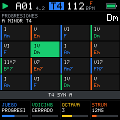
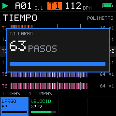
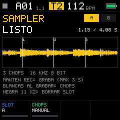

<p align="center"></p>

<p align="center"><b>Firmware de groovebox de 6 pistas para el M-VAVE FM-1.</b><br>
Diseño propio, escrito desde cero en C99.</p>

<p align="center">




</p>

---

## Estado (0.2.0)

| Parte | Estado |
|---|---|
| Núcleo (audio, secuenciador, UI, guardado) | **Completo y probado en PC**: 307 comprobaciones automáticas en verde |
| Emulador web (WebAssembly) | **Funciona**: el mismo código C, probado en Chromium |
| Port al FM-1 | **Esqueleto**: estructura, pines y escaneo de matriz probados; los drivers de registros están marcados `TODO(HW-VERIFY)`. **Aún no se ha flasheado ni probado en un FM-1.** Ver [`hal/fm1/README_PORT.md`](hal/fm1/README_PORT.md) |

## Pruébalo ahora

Abre **`web/index.html`** en Chrome o Edge (doble clic sirve) y pulsa *Encender*. Arranca con una demo. Dale PLAY con la barra espaciadora.

## Qué hace

- **Batería estilo TR** (T1): 16 instrumentos, cada uno con su línea, su largo (polímetro), acento, repetición ×2-×4, flam, P-Locks y pasos que solo suenan en el fill. **Roll** en vivo y **borrado** estilo TR mientras suena.
- **Sampler** (T2): graba la mezcla, marca chops en vivo y los secuencia en la misma rejilla TR. 2 slots de 4 s en flash.
- **Bajo y 3 synths** de wavetable con filtro, glide, arpegiador y **loopera** de notas por pista.
- **Tiempo por pista:** largo 1-64 y velocidad ×2, ×3/2, ×1, ×3/4, ×1/2, ×1/4. Largo maestro de 16 pasos a infinito.
- **Acordes en cuadrícula** estilo Maschine: 16 acordes con su grado y su función coloreada (reposo, preparación, tensión), juegos de progresiones, voicing conducido y strum.
- **Directo:** 4 escenas con cadenas y grabación de la canción, fills automáticos, 16 punch-in FX, mutes por pista y por instrumento.
- **Guardado seguro** en flash (log con CRC y commit al final, wear-leveling, autoguardado en STOP), MIDI IN, reloj y Split Sync.

## Cómo se toca, en corto

| Pulsación | Qué hace |
|---|---|
| **Toque** | Abre la pantalla del botón; otra vez, su página siguiente |
| **Mantener** 300 ms | Capa en vivo: SEQ patrones · HOME mute · EDIT borrar · FX punch-in · SCL acordes · ARP arpegio/roll |
| **Mantener 2 s** | Pantalla especial: SEQ tiempo · HOME sistema · EDIT sampler · REC borrar pista · SAVE guardado rápido |
| **GLO +** algo | Global: KNOB 1-4 = BPM, swing, largo maestro, drive |

El manual completo está en [`docs/MANUAL.md`](docs/MANUAL.md), el diseño de la 0.2 en [`docs/DISENO_0.2.md`](docs/DISENO_0.2.md) y la especificación técnica en [`docs/SPEC_V3.md`](docs/SPEC_V3.md).

## Compilar y probar

Todo corre en Docker (no hace falta compilador local). Requiere Python 3 con `numpy` y `Pillow` para los assets.

```sh
py -3 tools/build.py assets   # fuente, sonidos, ondas y logo
py -3 tools/build.py test     # pruebas en PC + capturas en assets/screens/
py -3 tools/build.py web      # emulador: web/bm.js
py -3 tools/build.py all
```

## Estructura

```
core/        el firmware (C99 puro, sin hardware): audio, secuenciador, UI, guardado
core/gen/    datos generados: fuente, kits, ondas, logo de arranque
hal/         capas de hardware: sim (PC/web), web (WebAssembly), fm1 (port)
web/         emulador en el navegador
tests/       pruebas automáticas
tools/       generadores de assets y build
docs/        especificación, manual, presupuesto de memoria
assets/      logo y capturas de pantalla
```

## Origen y licencias

- **Todo el código es nuevo** y no contiene código de Felucca, SLOOP ni Bubba Box. De la ingeniería inversa pública del FM-1 solo se usaron **hechos de hardware** (pines, tiempos, mapa de memoria), documentados con su fuente en `docs/SPEC_V3.md` §11.
- **Sonidos**: los dos kits se **sintetizan** en `tools/gen_assets.py` y las 16 ondas se generan por síntesis aditiva. No incluye samples de terceros. Se pueden cargar ondas AKWF (CC0) con `--akwf`.
- **Fuentes de pantalla** dibujadas a mano en `tools/gen_font.py`.
- **Logo**: el sol de Bubba Box, rediseñado para Machine (dientes de engranaje en vez de rayos).
- **Licencia del proyecto: pendiente** (decisión 1b de la spec). Al no reutilizar código GPL, puede ser la que elijas.

M-VAVE y FM-1 son marcas de sus dueños; este proyecto no está afiliado a ellos. Instalar firmware no oficial es bajo tu propio riesgo.
