# Bubba Machine 0.10 — Manual

Bubba Machine turns the FM-1 into a live groovebox with **six channels**, each one a machine named after the one that inspired it. The drums (**BR-8**, always T1) and the pad sampler (**BP-1**, the Slicer, always T6) are fixed; **T2-T5 choose their instrument** among **BB-303** (the TB-303), **B-MINI** (Minimoog), **BUNO-6** (Juno-6), **BITTAL** (wavetable, Vital) and **BX-7** (6-operator FM, the FM-1's own engine). HOME is the **BX-1** mixer: patterns, channels, mutes and scenes on the keys.

**The goal is a hi-fi machine:** every machine and the mix are computed live at 44.1 kHz / 24-bit in floating point, and each machine has its own engine modeled on the real one. See [Audio quality](AUDIO.md).

> The names recall famous machines (TR-8, TB-303, Minimoog, Juno-6, Vital, DX7, MX-1), but Bubba Machine has no relation to their brands or makers.

**Every machine is its own instrument.** On HOME you are at the mixer: you launch patterns, mute, solo, launch scenes and mix. Enter a channel and **the whole FM-1 belongs to that machine**: its buttons are that machine's menus and its knobs are its panel. **HOME is the way out**: a tap always takes you back to the mixer.

> **The screen is in English.** Names that appear on screen are written here in CAPITALS exactly as you will see them. Other languages are packs you load from the [control platform](../../web/control.html) (see [Screen language](#screen-language)).

> **First boot of 0.10:** the pattern format changed, so the saved patterns are erased **once** and the three factory patterns are loaded (see [Factory patterns](#factory-patterns)). Takes, your sounds and the settings are kept. Until v1 an update may erase what you saved.

## How the buttons work

- **Menu buttons open their page with one press.** Pressed again, a menu with several pages goes to its **next page, in a circle** (it does not exit); a menu with one page goes back to the machine's main page. Another menu, or HOME, leaves it. Holding a menu button does the same as a press.
- **Hold 2 s** only on three buttons: **HOME** (SYSTEM), **SAVE** (quick save) and **REC** (clear the channel). A ring fills at the top with the name of what it does.
- **SELECT never turns pages.** It moves a cursor where there is one (the channel, a step, a row, a block of 16 steps, an FX slot).
- **No help text on screen.** The screen names what each key and knob does; how to use it is in this manual.
- **A control with nothing to do here does nothing**, and its light is off.

## The lights

The FM-1's lights are white only: they never say *what* a key or button does (the screen does), only its state. The same levels mean the same thing on every screen:

| Light | Keys | Buttons |
|---|---|---|
| **Off** | Does nothing here: no function, an empty pattern or instrument, outside the length | Does nothing on this screen |
| **Dim** | Available but empty, or has something but is silenced (a muted instrument or channel) | Available |
| **Medium** | Has something and will play: an instrument with steps, a saved pattern or scene, the root note | — |
| **On** | Selected, held, active now, or **a flash on every hit** | Where you are, or a state that stays (octave shifted, REC on) |
| **Blink** | The playhead, or something queued (a pattern, a scene) | HOME when a pattern or scene is queued and you are not on the mixer; SAVE while a save waits for STOP |
| **Breath** | A step with a P-Lock | The layer that is open, REC armed, SAVE with unsaved changes, PLAY waiting for external clock |

**PLAY** flashes on with the first beat of each bar and medium on the other beats. On the screen's key strip, an off key has a dark name, dim has a grey name with a border, medium a white name and on is filled.

## The knobs

| Knob | On HOME (the mixer) | Inside a machine |
|---|---|---|
| **SELECT** | The **cursor**: picks the channel, top to bottom and around | A cursor where the page has one (the step on SEQ, a block of 16 steps on SCL, the FX slot on the BX-7) |
| **ALGORITHM** | The **tempo** (BPM) | The machine's main control (table below) |
| **PRESETS** | The cursor channel's **sound**: the kit, the preset, or the take of the selected pad | The sound: kit, preset, or the selected pad's take |
| **K1-K4** | The cursor channel as a mixer strip: **VOLUME** · **FILTER** (DJ: left low-pass, right high-pass) · **DELAY** · **REVERB** (the sends) | What the screen shows |

**ALGORITHM inside a machine:**

| Machine | ALGORITHM | OCT held + ALGORITHM |
|---|---|---|
| BR-8 | The instrument (a box shows its number and name; it is picked a moment later) | — |
| BP-1 | The pad | — |
| BB-303 | ACCENT | TUNING |
| B-MINI | CUTOFF | — |
| BUNO-6 | FREQ (the filter) | — |
| BITTAL | CUTOFF | — |
| BX-7 | The algorithm, 1 to 32 | TRANSPOSE ±12 |

**Each knob is drawn once.** Where the screen shows a machine's panel (or a list of four settings), the four dials at the bottom are not drawn again: the active knobs are in color, the rest grey. Elsewhere, the bottom strip shows K1-K4 as four dials with their value and name.

**The big knobs say what they do:** the bottom line reads **SEL · ALG · PRE** with their job on that screen (for example SEL TRACK · ALG BPM · PRE KIT on HOME), and "-" when the knob does nothing there.

**How they feel:**
- **Turning fast speeds up** continuous values (BPM, cutoff, start); **lists move one item per click**, never skipping.
- **On/off settings:** right = on (or next), left = off. They don't wrap around.
- **The DJ filter stops at the center** (OPEN) for two clicks, so it is easy to find.
- Turning K1-K4 shows the name and value on the top line, without covering the screen; on a panel you see the knob itself move. The big box is for SELECT, ALGORITHM, PRESETS and the tempo.

## The screen

Four strips, always in the same place:

1. **Header:** where you are (**BX-1** on the mixer; inside a channel its machine, with "<": HOME goes back), PLAY/REC, the pattern (**A01**), bar.beat, the active scene and the tempo in yellow.
   - A queued pattern reads **A01>A03**, with 4 blocks counting the beats to the change. A queued scene reads **>B**.
   - **Six tiny cells** show the channels: their color = playing, red = muted, white = a hit, outline = solo.
   - With external clock, **EXT** (or a red **EXT?** with no clock coming in) instead of BPM. A **green dot** = autosaved; **CPU!** only if the audio does not keep up.
   - The 2 s ring with what it does (SYSTEM, QUICK SAVE, CLEAR T3, DELETE SCENE A), and the battery.
2. **Viewport:** what each screen shows. Inside a machine, the page name at the top left (for example **PANEL 1/2**, **FX 2/2 DELAY REVERB**, **TRIM 1/2**) and its sound on the right. A layer opened on the drums says **LATCHED** and the sound page (**OCT 1-8** or **OCT 9-16**).
3. **Keyboard:** the 11 black and 16 white keys with what each one does and the same state as its light. On the mixer: 01-09, T1-T6, M1-M6 and A-D. On the step sequencers the white keys are the 16 steps. Short fixed names: drums BD, SD, CH, OH, CP...; pads P1-P16; < / > = bar; RPT = repeat.
4. **SEL · ALG · PRE:** what the three big knobs do here.

The palette: blue-black background, **cyan** for what is active, **amber** for values and the playing step, **red** for REC and mutes, **green** for long notes and slides.

## The buttons

| Button | On HOME | Inside a machine | 2 s |
|---|---|---|---|
| **HOME** | Stays on the mixer (and leaves PLAY/REC) | Back to the mixer | SYSTEM |
| **PLAY** | Play / stop | Play / stop (with REC armed it also starts recording) | — |
| **REC** | Opens **PLAY/REC** already recording; in PLAY/REC, REC on / off | Note machines: record (see [Recording](#recording-like-sloop)); BP-1: record the pads you play | **Clear the cursor channel at once**, playing or stopped |
| **SAVE** | The SAVE screen | The SAVE screen | Quick save |
| **GLO** | The mixer GLO (machines, tempo and scale, master FX) | The machine's GLO | — |
| **SEQ, EDIT, ENV, LFO, FX, SCL, ARP** | Enter the cursor channel's machine on that page (only the ones that machine has) | That machine's menus (see each machine) | — |
| **OCT − / +** | Nothing (in PLAY/REC: octave, or soft / hard hits on the drums) | The octave (note machines) or the sound page (step sequencers) | — |

## HOME: the mixer

HOME is a machine of its own, **BX-1**. One row per channel with its machine, its sequence (pulses for hits, green blocks for long notes), LP or HP when its filter is on, its volume and its peak. Channels appear in this order:

| Screen | Machine (factory) | Can be |
|---|---|---|
| **T1** | BR-8 | fixed |
| **T2** | BB-303 | BB-303, B-MINI, BUNO-6, BITTAL or BX-7 |
| **T3** | B-MINI | the same |
| **T4** | BUNO-6 | the same |
| **T5** | BITTAL | the same |
| **T6** | BP-1 (the Slicer) | fixed |

**Keys on the mixer:**

| Key | What it does |
|---|---|
| **White 1-9** | Patterns **01-09**. Chosen when you let go: playing, it **changes at the end of the bar** (blink = queued); stopped, it loads at once (and the one you leave is saved if it changed). On = playing, medium = saved, off = empty |
| **White 10** | Nothing: a gap so you don't change pattern by mistake |
| **White 11-16** | Channels **T1-T6**. Tap = move the cursor there. Tap the cursor's channel again = **PLAY/REC** (below). On = the cursor, medium = has steps (it flashes with each hit), dim = empty |
| **Black 1-6** | Mute T1-T6 (at once). **Hold = solo** while you hold it; tap other mute keys meanwhile to add them to the solo. Let go of the first one and the mutes are back as before |
| **Black 7** | Nothing |
| **Black 8-11** | **Scenes A-D** of this pattern (see [Scenes](#scenes)) |

**Knobs:** SELECT = cursor, ALGORITHM = BPM, PRESETS = the cursor's sound, K1-K4 = **VOLUME** (the same as each machine's VOLUME), **FILTER**, **DELAY** and **REVERB**.

**Entering a machine:** put the cursor on the channel and press one of its menu buttons: you enter on that page. Each machine lists its buttons below.

### PLAY/REC: play any channel from the mixer

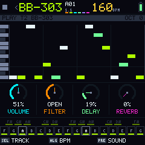

Tap the cursor's channel key again (or press **REC**, which enters already recording) and **the keys stop being the mixer: they play that machine** without entering it. The viewport shows the channel as a piano roll, with **PLAY T2 BB-303** (or **REC ...** in red) at the top. **HOME** gives the keys back to the mixer.

- **Note machines:** the 27 keys are chromatic from **F**; BB-303 and B-MINI play an octave lower. **OCT −/+** shift the octave (−2 to +2, shown at the top right). The keys of the scale are dim, the root medium (GLO › TEMPO AND SCALE).
- **Drums and pads:** the white keys are the 16 instruments or pads. On the drums, **hold OCT+** for hard hits (accent) and **OCT−** for soft ones.
- **SELECT** changes channel and the keyboard (and the recording) follows it. The knobs are still the mixer's.
- **REC** on / off. Recording works as inside the machines ([Recording](#recording-like-sloop)); drum and pad hits are added to their steps.

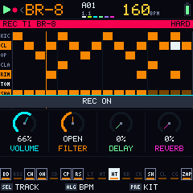

### GLO (the mixer's)

GLO on HOME opens three pages; **GLO again = the next page**, in a circle. HOME leaves. The mixer keys still work (patterns, mutes, scenes; white 11-16 move the cursor).

| Page | SELECT · ALGORITHM | K1 | K2 | K3 | K4 |
|---|---|---|---|---|---|
| **SELECT MACHINE 1/3** | the channel · its machine | — | — | — | — |
| **TEMPO AND SCALE 2/3** | — · BPM | SWING (50-75 %) | SCALE | ROOT | TRANSP (−12 to +12) |
| **MASTER FX 3/3** | — | DLY TIME (1/16, 1/8, 3/16, 1/4) | DLY FDBK | REV SIZE | REV MIX |

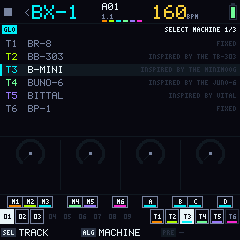

**Changing a machine (T2-T5):** on SELECT MACHINE, SELECT picks the channel and ALGORITHM turns to a machine. **Leave it 2 seconds** on one: a bar fills ("LOAD IN 1.4 S") and the channel becomes that machine. Moving away, or leaving GLO, cancels it. The notes, length and mix stay; the sound goes to the machine's first preset. The machine is saved with the pattern. T1 and T6 say FIXED. The same change is in each machine's GLO (K2 MACHINE).

**Heavy machines:** **BUNO-6**, **BITTAL** and **BX-7** each fit on **one channel only**, and **at most two heavy machines** play at once. A heavy machine already on another channel shows "ON T4"; a third one says "2 HEAVY ON T4 T5" (where they are, so you can change one). BB-303 and B-MINI can repeat.

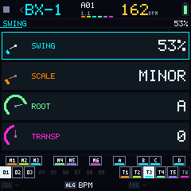 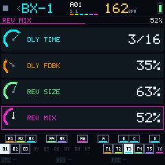

## Scenes

**A scene is a snapshot of the mutes**: the six channels' mutes and the instrument mutes of BR-8 and BP-1. Each pattern has its own four scenes, on **black 8-11** (A-D).

| Gesture | What it does |
|---|---|
| **Hold a pattern's white key + tap a scene** | Stores the mutes as they are now in that scene of that pattern |
| **Tap a stored scene** (medium) | Launches it on the next bar (stopped: at once). On = the active one, blink = queued. An empty scene does nothing |
| **Hold a scene 3 s** | Deletes it (a ring fills: DELETE SCENE A) |

**Scene B of every pattern comes with all six channels muted**, drums included: a quick way to drop everything and bring it back with A. It stays until you store another scene over it (deleting it leaves it empty).

## Factory patterns

On the first boot of 0.10 patterns 1-3 hold three recreations of famous tracks, played by the factory machines (no audio was sampled; the Slicer is empty):

| Pattern | Track | Tempo | Scenes |
|---|---|---|---|
| **01** | Da Funk | 111 BPM, swing 54 % | A everything · B all muted · C without the BB-303 · D the BB-303 with drums and bass |
| **02** | Blade (Confusion, Pump Panel reconstruction) | 136 BPM | A everything · B all muted · C drums and BB-303 · D without drums |
| **03** | Enjoy the Silence | 113 BPM | A everything · B all muted · C drums and bass · D without drums |

Patterns 04-09 start empty.

## Drums (BR-8)

T1 is a drum machine of 16 **modeled** instruments (computed live), with the kits **808**, **909** and **SYNTH** on PRESETS. From HOME with the cursor on T1: **SEQ** opens the sequencer, and **LFO**, **ENV**, **EDIT** and **SCL** open the sequencer with their layer. SEQ again (or HOME) goes back to the mixer.

The sequencer shows 8 instruments (a **sound page**: 1-8 or 9-16) × the 16 steps of the bar you see. Each line has its own playhead.

| Control | Does |
|---|---|
| **White keys** | The steps of the selected instrument: tap = set or clear. **Hold a step** and turn **K1** = its accent, **K2** = its repeat (X1-X4 or FLAM) |
| **Black 1-8** | Pick (and hear) an instrument of the sound page |
| **Black 9 · 10** | The previous / next bar, in a circle (dim with one bar only) |
| **Black 11 (RPT)** | **REPEAT**: tap = keep it open (black 11 again closes it), hold = only while held. The white keys cycle X1 › X2 › X3 › X4 › FLAM on each step |
| **OCT − / +** | The sound page: instruments 1-8 or 9-16 |
| **K1-K4** | **LEVEL** of the instrument · **LENGTH** of the whole kit (1-64 steps) · **DECAY** · **TONE** |
| **ALGORITHM** · **PRESETS** | The instrument · the kit |

**The layers** (one press opens it, the same button closes it; another button closes it and does its own job). On all of them **black 1-8** pick an instrument without sounding and **black 10 · 11** change the bar.

| Button | Layer | White keys | Knobs |
|---|---|---|---|
| **LFO** | **ACCENTS** | Accent on / off on each step (an empty step becomes a hit with accent). The 16 steps are drawn above their keys | K1 = how much accent (the channel's) |
| **ENV** | **SOUND** | Pick and hear an instrument; its hit is drawn | **TUNE · DECAY · TONE · COLOR** (COLOR is named after what it does in that model) |
| **EDIT** | **INSTRUMENT** | Pick an instrument | ALGORITHM = its **model** (any model on any instrument) · K1 MODEL · K2 LEVEL · K3 CHOKE |
| **SCL** | **MUTE SOUNDS** | Mute or unmute each instrument (black 1-8 too) | — |

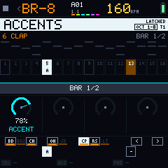

In MUTE SOUNDS the lights are fixed: on = plays, dim = muted, off = no hits.

BR-8's kicks, snares and hats are the **Plaits** models (Mutable Instruments), which imitate the 808 circuits and 909-style synthetic versions. With **accent** they hit differently, not just louder.

To record drums live, use [PLAY/REC](#playrec-play-any-channel-from-the-mixer) from HOME.

## The note machines

BB-303, B-MINI, BUNO-6, BITTAL and BX-7 share the same base:

- **Keys:** chromatic from F, played live. **OCT − / +** change the octave when you let go (±3); **both together** set octave and transpose back to 0.
- **PRESETS:** the machine's factory sounds; B-MINI, BITTAL and BUNO-6 also show the sounds you added from the control platform.
- **SEQ:** the channel as a **piano roll**, one page of 16 steps (the page of the playhead when playing, of the cursor when stopped). **SELECT** moves the step cursor. **K2 SPEED** (×2 to ×1/4), **K3 PAGE** (the 16 steps you see), **K4 SCROLL** (the pitches you see). SEQ again = the main page.
- **ARP** (2 pages): **MODE** (OFF, UP, DOWN, INCL, EXCL, RANDOM, ORDER, REPEAT) · **OCTAVE** (1-4) · **RATE** (1/8, 1/16, 1/32) · **GATE** (20-100 %); page 2: **LATCH**. With REC on, the arpeggio is recorded.
- **GLO** (2 pages): **LENGTH** (1-64 steps) · **MACHINE** (only the machines this channel can have now; leave it 2 s on one to load it) · **MIDI CH** · **MIDI OUT** (the channel also sends its notes over USB MIDI on its MIDI CH); page 2: **QUANT** (K3) · **RESET** (K4: turn it and the sound goes back to its preset). The BX-7 has **TRANSP** on K1 of page 2.

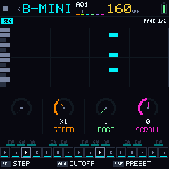

### Recording (like SLOOP)

Recording follows SLOOP: **the channel keeps its length**; at the end it goes around and what you play rewrites the steps you touch. Recording never makes a channel longer.

- **Playing:** REC records at once. The first time you touch a step in a pass, what was there is replaced; notes added in the same pass make a chord. Steps you don't touch stay. Each note keeps **how long you held it** (never longer than the bar it starts in, nor than the channel).
- **Stopped, outside SEQ:** REC arms (**REC ARMED: PLAY A NOTE**, REC breathes): the first note starts playback and records. PLAY also starts it.
- **Stopped, on SEQ: STEP REC.** The key (or chord) rewrites the step under the cursor and the cursor moves on when you let go; SELECT moves the cursor (skipping steps = rests). Each note is one step long.
- **QUANT** (GLO page 2): how much of your timing is corrected, **25 / 50 / 75 / 100 %** (100 % = exactly on the step). Only the start; the length stays as you held it.
- **REC held 2 s** clears the channel, playing or stopped.

### BB-303

The TB-303, after **Open303**: the 303's filter, the accent circuit, slide and the TB-303's knob ranges, with the TB-03's effects. 12 sounds.

| Button | Page |
|---|---|
| **EDIT** | The **panel**: page 1 **CUTOFF · RESO · ENV MOD · DECAY**; page 2 **TUNING · WAVE** (SAW / SQUARE) **· SLIDE** (its time) **· VOLUME**. ALGORITHM = **ACCENT** |
| **SEQ** | The piano roll (accents in white, slides in green) |
| **SCL** | **ACCENT** of each step: the 16 white keys are the 16 steps of the block (on = accent, dim = has a note); SELECT changes block. SCL again: **SLIDE** of each step |
| **FX** | Page 1 **OVERDRIVE** (DRIVE, TONE, LEVEL, ON); page 2 **DELAY** · DLY ON · **REVERB** · REV ON. DELAY and REVERB are the channel's sends (the same as on HOME). Fixed order: OVERDRIVE › DELAY › REVERB |
| **LFO** | An addition (the 303 has none): **RATE** (1/16 to 8 BARS, locked to the tempo) · **DEPTH** · **WAVE** (SINE, TRIANGLE, SAW UP, SAW DOWN, SQUARE, S&H and the patterns PUMP, GATE, STEPS, 3-3-2, BUILD) · **DEST** (CUTOFF, PITCH, RESO, VOLUME) |
| **ARP** · **GLO** | As on every note machine |

**Slide live:** press the next key before letting go of the last one (legato) and the note slides; with REC on it is recorded as a slide to the next note. ENV does nothing on the BB-303.

### B-MINI, BUNO-6 and BITTAL

The three panel machines share one layout, after the Behringer POLY D: each section of the real panel on its button, the sections as tabs at the top and four big knobs. Under the panel, a drawing of what you edit (the filter curve, the oscillator's wave, the envelope).

| Button | B-MINI (Minimoog) | BUNO-6 (Juno-6) | BITTAL (Vital) |
|---|---|---|---|
| **EDIT** | **FILTER** (CUTOFF, EMPHASIS, CONTOUR, KBD CTRL) · **OSC 1** (RANGE, WAVE, LEVEL, TUNE) · **OSC 2** and **OSC 3** (RANGE, FREQ, WAVE, LEVEL; OSC 3 has the LO range) · **OUTPUT** (NOISE, GLIDE, MODE, VOLUME) | **VCF** (FREQ, RES, ENV, LFO) · **DCO** (RANGE, PULSE, SAW, SUB) · **DCO MOD** (LFO, PWM, PWM MODE, NOISE) · **VCF MOD** (HPF, ENV +/-, KYBD, VELO) · **VCA** (ENV/GATE, VELO, VOLUME) | **OSC 1 / OSC 2** (LEVEL, TRANSP, FRAME, UNISON) · **OSC 1 + / OSC 2 +** (DETUNE, FINE, TABLE) · **FILTER** (MODEL, CUTOFF, RESO, DRIVE) · **FILTER +** (ENV2 AMT, KEYTRK, VELO, ENV2 POS) · **VOICE** (MODE, GLIDE, VELO, VOLUME) |
| **ENV** | **FILTER** and **LOUDNESS** contours (ATTACK, DECAY, SUSTAIN, RELEASE) | One ADSR | **ENV 1** and **ENV 2** (ADSR) |
| **LFO** | RATE · WAVE (TRI, SQUARE) · **MOD MIX** (OSC 3 ↔ LFO) · AMOUNT; page 2 **DEST** (OSC, FILTER, BOTH) | RATE · DELAY | SHAPE · RATE · DEST · AMOUNT; **MACRO 1-2** and **MACRO 3-4**: where each macro goes and how much |
| **ALGORITHM** | CUTOFF | FREQ | CUTOFF |

The same on the three:

- **FX:** page 1 **DISTORTION** (DRIVE, TONE, LEVEL, ON); page 2 **CHORUS** (OFF, I, II; the BUNO-6 also I+II) · **REVERB** (the channel's send) · REV ON. Their **delay is set from HOME** (K3).
- **SCL:** **ACCENT** of each step on the 16 white keys (SELECT = block of 16); SCL again: **GLIDE** of each step.
- **SEQ, ARP, GLO** as on every note machine.

BITTAL draws under its panel **the waves of its two tables** at their position (the one that plays; silent, the FRAME setting).

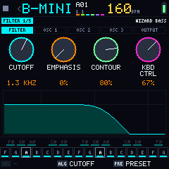 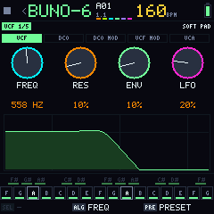 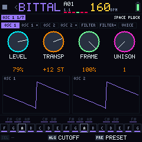

### BX-7

The FM-1's own FM engine inside Bubba: 6 operators (msfa, the core of Dexed) and the DX7's 32 algorithms. 31 factory patches; your .syx banks are not offered on the FM-1 for now.

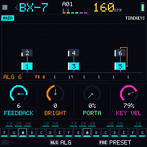

| Button | Page |
|---|---|
| **MAIN** (a one-page menu's button again) | The algorithm drawn as on a DX7 (carriers at the bottom, modulators above, feedback as a loop, each operator's level), and **FEEDBACK · BRIGHT · PORTA · KEY VEL** |
| **EDIT** | **Black 1-6 = OP1-OP6**, each in 6 pages (RATES, LEVELS, FREQ, OUTPUT, SCALING, CURVES; EDIT again = next page) · **black 7 PIT** (PITCH RATES, PITCH LEVELS) · **black 8 GLO** (VOICE: ALGORITHM, FEEDBACK, OSC SYNC, TRANSP) · **black 9 MONO · black 10 POLY**. The white keys keep playing |
| **ENV** | ATTACK · DECAY · SUSTAIN · RELEASE, on top of the patch's envelopes |
| **LFO** | Page 1 WAVE · SPEED · PMD · AMD; page 2 DELAY · P SENS · LFO SYNC · OSC SYNC |
| **FX** | Its own chain of six slots, one at a time: **FILTER** (TYPE LP/BP/HP, CUTOFF, RESO), **REVERB** and **DELAY** (SEND: the channel's sends), **DIST** (GAIN, TONE, LEVEL), **CHORUS** and **PHASER** (RATE, DEPTH, MIX); K4 = ON on all. SELECT moves between slots. **SCL** picks up the slot and SELECT moves it along the chain (SCL again places it); REVERB and DELAY always go after the effects. Only the slots that are on process |
| **SEQ · ARP · GLO** | As on every note machine (GLO page 2 has TRANSP) |

ALGORITHM changes the algorithm (with the drawing in view you see it change). OCT held + ALGORITHM = transpose.

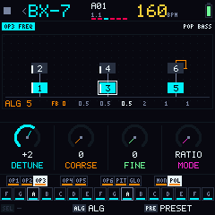 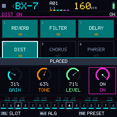

## The Slicer (BP-1)

T6 is a **16-pad sampler**, like a KO II: each pad is a piece of a take (its own start and length; pads may overlap), played by a step grid like the drums'. From HOME with the cursor on T6: **SEQ** opens the grid, **LFO** and **SCL** the grid with their layer, and **EDIT**, **ENV** and **FX** the machine's pages.

**How you work:**

1. **Get a take:** upload it from the [control platform](../../web/control.html), or record what is playing with **SMP** (below).
2. **Put it on a pad** (PRESETS = the whole take on the selected pad) and **cut it** in TRIM: **AUTO** (on the hits), **8** or **16** equal parts go to pads 1 to n, and **the sequence is written** so the grid plays like the take.
3. **Tune each pad** (TRIM, SOUND, ENV) and **program the grid** (SEQ).

### SEQ: the pad grid

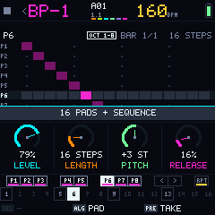

Just like the drums: 8 pads per page (OCT −/+ = pads 1-8 or 9-16), the 16 steps of the bar, **black 1-8** pick (and play) a pad, **black 9 · 10** change the bar, **black 11 (RPT)** = REPEAT, and a held step + K1 / K2 = its accent / repeat.

| Control | Does |
|---|---|
| **K1-K4** | **LEVEL** of the pad · **LENGTH** of all pads (1-64 steps) · **PITCH** (±24 semitones) · **RELEASE** |
| **ALGORITHM** · **PRESETS** | The pad · its take |
| **LFO** · **SCL** | **ACCENTS** · **MUTE SOUNDS** (as on the drums) |
| **SEQ again** | **LENGTH/SPEED** (below) |
| **EDIT · ENV · FX · GLO** | The machine's pages |

**LENGTH/SPEED** (SEQ again): each pad can have its own length.

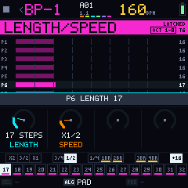

| Key | Does |
|---|---|
| **White keys** | The **length of the selected pad** (1-16; on = the length, medium = inside it, dim = outside) |
| **Black 1-6** | The channel's **speed**: ×2, ×3/2, ×1, ×3/4, ×1/2, ×1/4 |
| **Black 7-10** | 1, 2, 3 or 4 bars (1BR-4BR) |
| **Black 11 (+16)** | The lengths 17-32, 33-48, 49-64 and back |
| **K1 · K2 · ALGORITHM** | Length of the pad · speed · the pad |

### The Slicer's pages

The white keys are always the 16 pads (play and select; on = selected, medium = has sound). ALGORITHM = the pad, PRESETS = its take.

| Button | Page | K1 | K2 | K3 | K4 |
|---|---|---|---|---|---|
| **EDIT** | **TRIM 1/2**: the waveform of the pad's take with the pad marked | START (the end stays) | LENGTH | ZOOM (X1-X8) | SAMPLE: how many bars **SMP** records (1, 2 or 4, as many as fit) |
| **EDIT again** | **SOUND 2/2** | PITCH (±24 st) | LEVEL | MODE: ONESHOT, KEY, THRU, LOOP | REVERSE (FWD / REV) |
| **ENV** | **ENV** | ATTACK | RELEASE | LOOP IN | LOOP OUT (only in LOOP mode) |
| **FX** | DISTORTION; again CHORUS and REVERB | as on the panel machines | | | |
| **GLO** | **GLO 1/2** | LENGTH (all pads) | — | MIDI CH | MIDI OUT |
| **GLO again** | **GLO 2/2** | — | — | — | RESET (the pads' sound and the FX back to factory; the cuts stay) |

**In TRIM, the black keys:** **AUTO**, **8** and **16** cut the selected pad's take (lit when it has one) and **always rewrite the sequence**; **SMP** (black 11) records **the mix** from the next bar (stopped: it starts with PLAY), for the bars on K4. SMP again stops. The new take is saved when you stop the transport and goes on the selected pad. The header shows **SAMPLING 1.2 S** while it records.

**MODE (how a pad answers the key):** **ONESHOT** plays whole even if you let go · **KEY** plays while you hold · **THRU** plays the pad and, held, keeps going through the rest of the take · **LOOP** repeats while you hold, between LOOP IN and LOOP OUT.

**REC** inside the Slicer records the pads you play into the grid (while playing); **REC 2 s** clears the sequence. OCT and ARP do nothing here.

**How much fits:** up to **6 s of takes in total** (8 bits at 16 kHz), up to about 3 s per take, in up to 8 takes. They share a 100 KiB flash zone with your sounds; the control platform shows all the memory.

## Saving

- There are **9 patterns** (01-09), on HOME's white keys. Each keeps its machines, sounds, sequences and its four scenes.
- The flash is **only written when stopped** (writing pauses the audio for a moment).
- **Autosave:** when stopped, 10 s after the last change (patterns, scenes and settings).
- **SAVE** opens its screen; SELECT picks the row, ALGORITHM (or K1, or PRESETS) the target pattern, and **SAVE runs it**:

| Row | Does |
|---|---|
| **SAVE** | Saves this pattern (and its scenes if they changed) |
| **SAVE AS** | Saves it in another pattern (the target) |
| **CLEAR PATTERN** | SAVE again within 3 s clears all six channels |

- **Playing, a save waits:** "SAVES WHEN STOPPED", SAVE blinks, and it is written when you stop. **SAVE 2 s** anywhere = quick save.

## System (HOME 2 s)

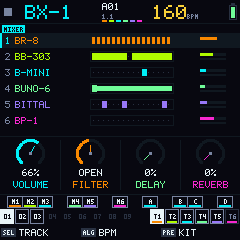

SELECT picks the row; ALGORITHM (or K1) changes it.

| Row | Values |
|---|---|
| **CLOCK** | INTERNAL or EXTERNAL (MIDI) |
| **SYNC OUT** | STEREO, or SPLIT L/R (left = clock pulses, right = mono mix) |
| **IDLE LEDS** | The brightness of idle buttons: OFF, DIM or MEDIUM (the keys are not affected) |
| **LANGUAGE** | English or the loaded pack |
| **VERSION** | The firmware version |

## MIDI

- **Input:** MIDI channels 1-6 play the channels in this order: 1 = BR-8 (T1), 2 = BP-1 (T6), 3 = T2, 4 = T3, 5 = T5, 6 = T4. These are also each channel's factory **MIDI CH**. On the drums the note picks the instrument.
- **External clock** (SYSTEM › CLOCK): follows MIDI Clock and Start / Stop. PLAY waits for the clock ("EXT CLOCK: WAITING FOR MIDI").
- **Output:** MIDI Clock when the clock is internal, and the notes of every channel with **MIDI OUT** on (GLO of the machine), on its **MIDI CH**.

## Control platform

The [control platform](../../web/control.html) manages the FM-1 from Chrome or Edge, over USB. It is one page that mirrors the FM-1, and **every change waits until you send it**: you can prepare everything without the FM-1 and send it later.

- **The bar on top** (it stays in view): whether the FM-1 is connected and which version it runs (with a link to the installer when a newer one is out), the **memory** that takes and sounds share (100 KB: what is used, what your pending changes add or free, and what will be left, in KB and in seconds of take), and the **pending changes** with **Send to FM-1** and **Discard**. Anything that would not fit is marked in red and Send stays off until you fix it.
- **TAKES:** the 8 take places as the FM-1 numbers them, with length, bars and BPM. Drop an audio file (WAV, AIFF, MP3, FLAC or OGG) on a free place, or on a take to replace it. Trim the start and end on the waveform, check the BPM (read from the file name, or guessed) and press **▶ Hear it as the FM-1 plays it**: 16 kHz, 8 bits with dither, exactly what is sent. Up to 3 s per take and 6 s in total. On the FM-1 a take goes on a pad with PRESETS (in the Slicer, or on HOME with the cursor on T6).
- **SOUNDS:** one column per machine. Vital presets (.vital) go to B-MINI, BITTAL or BUNO-6 (you pick; changing the machine or the name converts it again), and .bsnap files to their own machine. You see what was kept, approximated or left out, can rename it and download the .bsnap. Up to 12 of your sounds; on the FM-1 they come after the factory ones on PRESETS. BB-303 and BX-7 only have factory sounds for now.
- **SCREEN LANGUAGE:** English (built in), Español (pack included) or your own .bmlang.
- **DEVICE** (folded): firmware, audio load, system memory, how long it has been on, how it last started, the lowest voltages and the device log.

**Send** waits for the transport to stop (writing flash cuts the audio: the page says "Press STOP on the FM-1"). Deletions go first, so they make room; then the rest in order, with a progress bar. Afterwards the page reads the FM-1 again and marks each change **Verified on the FM-1**; anything that failed stays pending with the reason. Without a device, `control.html?mock=1` talks to a simulated FM-1 for development.

## Screen language

The screen is in **English**. Other languages are **packs** that are not loaded by default: one pack lives in its own 16 KiB of flash (it does not touch patterns or takes, and a firmware update does not erase it).

- **Load Spanish on the FM-1:** on the [control platform](../../web/control.html), with the FM-1 connected and the transport stopped. Or from the computer, with the transport stopped, `py -3 tools/fm1/idioma.py lang/es.bmlang` (`--quitar` removes it). **SYSTEM › LANGUAGE** then switches between English and the pack.
- **Making a translation:** copy `lang/plantilla.txt` (every phrase on screen) to `lang/<code>.txt`, write the translation under each phrase and build it with `py -3 tools/gen_lang.py`. The FM-1 font is ASCII: no accents. What you don't translate shows in English.
