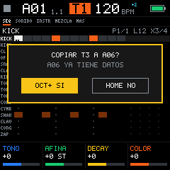
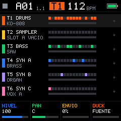
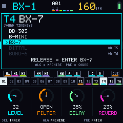
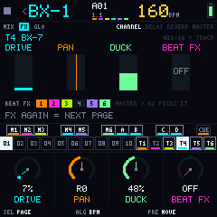
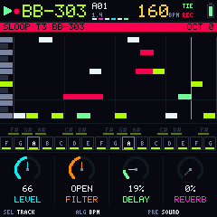
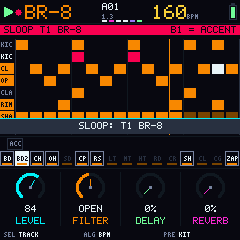
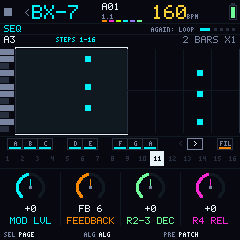
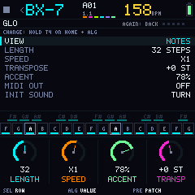
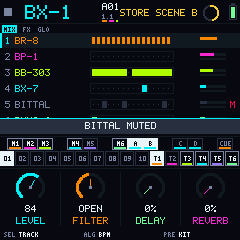
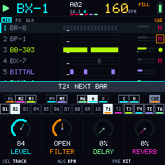

# Bubba Machine 0.9 — Manual

Bubba Machine turns the FM-1 into a live groovebox with **six channels**, each one a machine named after the one that inspired it. The drums (**BR-8**) and the pad sampler (**BP-1**) are fixed; **T3-T6 choose their instrument** among **BB-303** (acid bass), **B-MINI** (three-oscillator mono), **BX-7** (6-operator FM), **BITTAL** (wavetable that loads Vital presets) and **BUNO-6** (polysynth with chorus). HOME is the **BX-1** console: patterns, channels, mutes and scenes on the keys. Every channel has its own length and its own speed.

> The names recall famous machines (TR-8, OP-1, TB-303, Minimoog, DX7, Vital, Juno-6, MX-1), but Bubba Machine has no relation to their brands or makers.

The interface fits in two sentences: **four gestures per button, and they mean the same thing on every button. HOME everywhere.**

**Every machine is its own instrument.** On HOME you are at the BX-1 console, like a mixer for live sets: you launch patterns, mute, solo, launch scenes and mix. Enter a channel and **the whole FM-1 belongs to that machine**: its keys, buttons, knobs and lights work like the real machine it is named after, and you only edit a machine from inside it. **HOME is the way out**: a tap always takes you back to the console.

> **The screen is in English.** Names that appear on screen are written here in CAPITALS exactly as you will see them. Other languages are packs you load from the [control platform](../../web/control.html) (see [Screen language](#screen-language)).

> 0.9 has **10 patterns**. Coming from 0.8, patterns 01-10 are kept; 11-16 are dropped, and the song and the scenes start empty (their format changed). Until v1 an update may erase what you saved.

## Four gestures per button

| Gesture | When | What it does |
|---|---|---|
| **Tap** | under 300 ms | Opens its page on the channel you are on. Again: the next page of the same button |
| **Hold** | 300 ms or more | Its **live layer**: while you hold it, the keys do that job and the screen draws the keyboard with what each key does. Let go and you are back |
| **Hold 2 s** | 2 s without touching anything else | Its settings or its dangerous action. A ring fills at the top with the name of what it opens; touching anything cancels it. Only on HOME, SEQ, EDIT, SAVE and REC |
| **HOME + button** | with HOME held | The **global version** of the button: for the whole project, not just the channel |

There are never two layers at once: with a layer open, holding another button does not open its own.

**Questions.** Anything that erases something asks first, and **the control that asked answers**: keep it held 2 s and a bar fills (**KEEP HOLDING EDIT = YES**); letting it go before, or touching any other control, is no. While a question is open only that control blinks. If a knob asked (for example INIT SOUND in the machine GLO), leaving it 2 s without touching anything else is yes.

## The lights

The FM-1's lights are white only: they never say *what* a key or button does (the screen does), only its state. The same six levels mean the same thing on every screen:

| Light | Keys | Buttons |
|---|---|---|
| **Off** | Does nothing here: no function, an empty instrument, outside the length | Does nothing on this screen |
| **Dim** | Available but empty, or has something but is silenced (a muted instrument or channel) | Available |
| **Medium** | Has something and will play: an instrument with steps, a saved pattern or scene, the root note | Has a special job right now (with HOME held, the ones that have a HOME + function) |
| **On** | Selected, held, active now, or **a flash on every hit** | Where you are, or a state that stays (octave shifted, note REC) |
| **Blink** | The playhead, or something queued (a pattern, a scene, a mute on CUE) | Needs you now: the control that asked a question, REC capturing, HOME with a pattern or scene in the queue |
| **Breath** | A step with P-Lock, the EXIT key of a layer opened with a tap, CUE armed, the channel card you hold | Armed or pending: REC armed, the layer you hold, SAVE with unsaved changes (on the console), PLAY waiting for external clock |

**PLAY** flashes on with the first beat of each bar and medium on the other beats. On the screen's key strip, an off key has a dark name, dim has a grey name with a border, medium a white name and on is filled.

## The knobs

| Knob | On HOME (the console) | Inside a machine |
|---|---|---|
| **SELECT** | The **cursor**: picks the channel (on FX and GLO: the page or the row) | The page (its name and dots at the top) or the row of a list. With a step held, its accent |
| **ALGORITHM** | The **tempo** (HOME + ALGORITHM: in tenths). On GLO, the value of the row | The machine's **mode** (table below). On a list, it changes the highlighted value |
| **PRESETS** | On MIX: the cursor channel's **sound** (kit, patch or sound). On FX and GLO: **MOVE** (below) | The sound: kit, patch or a sound from the bank |
| **K1-K4** | On MIX, the cursor channel as a mixer strip: **LEVEL** · **FILTER** (DJ: left low-pass, right high-pass) · **DELAY** · **REVERB**. On FX and GLO, what the page shows | Whatever the four dials at the bottom say |

With **HOME held** from any screen: SELECT moves the cursor, ALGORITHM sets the BPM in tenths, PRESETS picks a pattern that loads when you let go, and K1-K4 are the cursor's mixer strip.

**Entering a machine:** on HOME, put the cursor on the channel (SELECT, or tap its white key 11-16) and tap **SEQ**, **EDIT**, **ENV**, **LFO** or **ARP**: you enter on that page. Or hold the channel's white key and let go (the [channel card](#the-channel-card)). From any screen, **HOME + white 11-16** takes you to that machine when you let go of HOME.

**ALGORITHM inside a machine (the mode):**

| Machine | ALGORITHM |
|---|---|
| BR-8 | Picks the instrument (with the box: big number, its name and model) |
| BP-1 | Picks the pad |
| BB-303 | The waveform: SAW or SQUARE |
| B-MINI | MONO or LEGATO |
| BX-7 | The algorithm, 1 to 32 |
| BITTAL | Oscillator 1's table: its own or another bank sound's |
| BUNO-6 | The chorus: OFF, I, II or I+II |

**Priority:** a question > the channel card > a layer > REC on a note channel > held step > list > channel > HOME.

**The big knobs say what they do:** the bottom line of the screen reads **SEL · ALG · PRE** with their job on that screen (for example SEL TRACK · ALG BPM · PRE KIT on MIX), and "-" when the knob does nothing there.

**How they feel:**
- **Turning fast speeds up** continuous values (BPM, cutoff, start); **lists move one item per click**, never skipping.
- **On/off settings:** right = on (or next), left = off. They don't wrap around.
- **MOVE, the DJ filter and PAN stop at the center** for two clicks, so 0 is easy to find.
- **SELECT goes through a page's sub-pages first** (SOUND, INSTR, PADS, ENV, MIX › DUCK), then to the next tab.
- Turning K1-K4 shows the name and value on the top line, without covering the screen; the big box is only for SELECT, ALGORITHM, PRESETS and the tempo, and it names the knob you turned.

## The screen

Four strips, always in the same place:

1. **Header:** the machine you are on (BX-1 on the console; inside a channel, "<" and its name: HOME goes back), PLAY/REC, pattern and bar and the tempo in its own yellow.
   - A queued pattern reads **A01>A05**, with 4 blocks counting the beats down to the change.
   - **Six tiny cells** show the channels: their color = playing, red = muted, white = a hit, outline = solo.
   - **SONG** when the song is on; a **green dot** = autosaved; "CPU!" only if the audio does not keep up; while recording notes, the gate they are recorded with (TIE or G75%).
   - The 2 s ring, with the name of what it opens, and the battery.
2. **Viewport:** what each screen shows. On the console, its pages **MIX · FX · GLO** at the top (on FX and GLO, their sub-pages on the right). Inside a machine, the page name and one dot per page, **O+1 / O-1** when the octave is shifted and **AGAIN: ...** with what tapping the page's button again does. The usage hints show for the first 4 seconds; **the line that says how to exit stays**. A layer opened with a tap says **LATCHED**.
3. **Keyboard:** the 11 black and 16 white keys with what each one does and the same state as its light. On the console: 01-10, T1-T6, M1-M6, A-D and CUE. On SEQ **the white keys are the 16 steps**; on a note channel, a mint bar marks long notes. Short fixed names: drums BD, SD, CH, OH, CP, LT...; HI / LO = the other section; < / > = step page; FIL = fill; X = exit.
4. **Knobs:** K1-K4 as four dials with their value and name, in physical order; under them, what SELECT, ALGORITHM and PRESETS do.

The palette: blue-black background, **cyan** for what is active, **amber** for values and the playing step, **laser red** for REC and mutes, **mint green** for long notes. A **red border** = the mix clipped.

## The 14 buttons

| Button | Tap | Again | Hold (layer) | 2 s | HOME + |
|---|---|---|---|---|---|
| **HOME** | Back to the console, always on **MIX** | — | **The console** from any screen (see below) | SYSTEM | (it is the modifier) |
| **SEQ** | The channel's steps (on the console: enters the cursor's machine) | Notes: LOOP · sampler: BREAK | **Length and speed** | TIME of the 6 channels | Console GLO › SONG |
| **EDIT** | SOUND (BP-1: PADS) | The editor's next page | **Erase** (on the console, black 7-10 clear a scene) | Sampler: TAKES · others: INIT SOUND (asks) | Copy the channel to another |
| **ENV** | The machine's envelope · INSTR (drums) | The other envelope | **Accent** | — | — |
| **LFO** | The machine's LFO (B-MINI, BITTAL, BUNO-6). On machines without an LFO it **latches its layer**: repeat (BR-8, BP-1) or tie (BB-303, BX-7); LFO again or HOME closes it | — | **Repeat** (grids) · **tie** (notes) | — | — |
| **FX** | Inside: the channel's MIX. On the console: the **FX** page | Inside: DUCK. Console: CHANNEL › DELAY › REVERB › MASTER | **Punch-in** | — | The console's FX page |
| **SCL** | Inside: the channel's SCALE. On the console: GLO › SCALE | CHORDS | Live **chords** | — | Console GLO › SCALE |
| **ARP** | Notes: the channel's ARP. BR-8 and BP-1: the **ROLL** screen, kept open (ARP again or HOME closes it) | — | **Arpeggio** (notes) · **ROLL** while held (grids) | — | — |
| **SAVE** | Save menu | Run it | **Copy pattern** | Quick save | Save as |
| **GLO** | Inside: the **machine GLO**. On the console: the **console GLO** | Machine: back to the page you were on. Console: TEMPO › MACHINES › SCALE › SONG | **Transpose** and TAP tempo | — | Console GLO |
| **REC** | Record. On the console: **SLOOP-REC**. On the sampler: the recorder | Looper: overdub › play | Record only while held (on the console: SLOOP while held) | **Erase the channel at once, no question** (for live use; HOME + OCT− undoes it). Not while anything is recording, nor on RECORD or TAKES. LOOP page: erase the loop | SONG REC |
| **PLAY** | Play / stop | — | — | — | Back to step 1 without stopping |
| **OCT − / +** | **Octave** of the keys on note machines (on the console too, for SLOOP). Nothing on drums and pads | — | — | — | Undo / redo |

## HOME: the console

The FM-1 has no SHIFT, so HOME does three jobs:

1. **The BX-1 console:** HOME is a machine of its own, with three pages: **MIX**, **FX** and **GLO**. A HOME tap always goes to MIX; FX opens FX and GLO opens the console GLO. MIX has one row per channel with its machine, its sequence (pulses for hits, mint blocks for long notes), LP or HP when its filter is on, and its volume with the peak.
2. **The console that follows you:** holding HOME brings the console keys to any screen. You edit the bass and, without leaving, mute, launch a scene or queue the next pattern.
3. **Modifier:** HOME + button = its global version (table above).

If you used HOME as a modifier, letting go does **not** take you to the console: HOME only navigates on a clean tap. While you hold HOME, only the buttons with a HOME + function are lit (OCT−/+ only when there is something to undo or redo).

To clear a channel: REC held 2 s (instant; on the console, the cursor channel) or EDIT held + black 3 (CLR); HOME + OCT− undoes either.

**Keys on the console (on HOME, or while holding HOME anywhere):**

| Key | What it does |
|---|---|
| **White 1-10** | Patterns **01-10**. Tap = queue it for the next cycle (when stopped: switches right away). Hold one and tap another: **chain** from the first to the second. On = playing, blink = queued, medium = saved, dim = empty |
| **White 11-16** | Channels **T1-T6**. Tap = the cursor. Hold = the **channel card** (below). With HOME held: go to that machine when you let go of HOME |
| **Black 1-6** | Mute T1-T6. Hold = **solo** while you hold it |
| **Black 7-10** | **Scenes A-D** (see [Scenes and song](#scenes-and-song)) |
| **Black 11** | **CUE**: hold it (or tap it to keep it on) and the mutes you tap change together on the next bar |

Mutes are live: they stay when the pattern changes.

### The channel card

**Hold a channel's white key (11-16)** on the console and its card opens: its machine, its sound and, on T3-T6, the five machines it can be. **Let go = enter** that machine, on the page you last used. While you hold it:

- **ALGORITHM changes the machine** (T3-T6). Turn to one and leave it **2 seconds**: a bar fills ("LOAD IN 1.4 S") and the channel becomes that machine. Moving away, or letting go of the key, cancels it. The notes, length, loop, ARP, scale and mix stay; the sound goes to the machine's first preset and per-note P-Locks are cleared. The machine is saved with the pattern.
- **PRESETS changes its sound** (kit, patch or sound).
- Turning any knob means **letting go stays on the console** (RELEASE = STAY ON MIX).

**Heavy machines, one at a time:** **BUNO-6** (it uses about a third of the processor) and **BITTAL** (its wavetables fill the memory) can only be on one channel. On another channel they show dimmed with "ON T6" and the screen says "BUNO-6 ALREADY ON T6". BB-303, B-MINI and BX-7 can repeat (a BX-7 on T3 is polyphonic too). The same rule applies when copying a channel or loading a pattern.

The same change is in **GLO › MACHINES** (below).

### MIX

SELECT moves the cursor, ALGORITHM is the tempo (the tempo box is yellow and its four blocks flash with the beat), PRESETS changes the cursor channel's sound (a kit change can be undone with HOME + OCT−) and K1-K4 are its **LEVEL**, **FILTER**, **DELAY** and **REVERB**.

### FX

FX on the console opens the FX page; FX again (or SELECT) goes **CHANNEL › DELAY › REVERB › MASTER**. ALGORITHM is still the tempo and **PRESETS is MOVE**.

| Page | K1 | K2 | K3 | K4 |
|---|---|---|---|---|
| **CHANNEL** (the cursor; white 11-16 change it) | **DRIVE** (the channel's soft-clip; 0 = off) | **PAN** | **DUCK** (sidechain from the T1 kick; T1 is the source) | **BEAT FX** ON/OFF: whether the BEAT FX and the punch-ins touch this channel |
| **DELAY** | TIME (1/16, 1/8, 3/16, 1/4) | FEEDBACK | MIX | SIDECHAIN RELEASE |
| **REVERB** | SIZE | DAMP | MIX | SIDECHAIN RELEASE |
| **MASTER** | **FILTER** (open in the middle; left low-pass, right high-pass) | **BEAT FX** (one of the 16 punch-in effects stays on until you turn it back to OFF) | **DRIVE** (saturation of the mix) | — |

**MOVE** (PRESETS on FX and GLO): at 0 the mix is untouched. To the left the master low-pass closes and the whole mix goes into the echo (darker, more repeats); to the right the master high-pass opens and the mix washes into the reverb. It is a live control: it is not saved.

### GLO (the console's)

GLO on the console opens its global list; GLO again goes **TEMPO › MACHINES › SCALE › SONG**. SELECT picks the row, ALGORITHM changes it and PRESETS is MOVE.

| Page | Rows | K1-K4 |
|---|---|---|
| **TEMPO** | BPM · SWING · MASTER LENGTH · TRANSPOSE · **AUTO FILL** (OFF, every 2, 4 or 8 bars) | BPM · SWING · MASTER · TRANSPOSE |
| **MACHINES** | T1-T6 and their machine. SELECT picks T3-T6 and ALGORITHM changes its machine, with the same 2 s wait and heavy-machine rule as the card | — |
| **SCALE** | ROOT · SCALE · **KEYS IN SCALE** · BASE CHORD (the project's) | the same four |
| **SONG** | The song's entries (see [Scenes and song](#scenes-and-song)) | PATTERN · TIMES · — · SONG ON/OFF |

SCL on the console (or HOME + SCL) opens GLO › SCALE; HOME + SEQ opens GLO › SONG.

## SLOOP-REC: play any channel from the console

**REC on the console** (MIX or FX) arms the cursor channel and **the keys stop being the console: they play that machine**, without entering it. The viewport shows the channel as a piano roll, with **SLOOP T3 BB-303** in red at the top. REC again (or entering a machine) gives the keys back to the console. **Holding REC** = SLOOP only while you hold it.

- **Note machines:** the 27 keys are chromatic from **F**; bass machines (BB-303, B-MINI) play an octave lower. OCT−/+ shift the octave (shown at the top right). With **KEYS IN SCALE** on (GLO › SCALE), the white keys play the scale and the black keys its chords.
- **Drums and pads:** the white keys are the 16 instruments or pads; hold **black 1 (ACC)** and the hits you play go with accent.
- **Recording:** while playing, what you play is written with the [expressive REC](#expressive-rec); the notes of this pass show in **red**. On an **empty** note channel it is a **FREE REC** (the length closes when you leave SLOOP or change channel). Stopped, the keys only play.
- **SELECT** changes channel and the keyboard follows it. **Holding HOME** gives you the console keys (mutes, scenes, patterns) while you hold it.

## The six machines

| Channel | Machine | What it is | Tabs |
|---|---|---|---|
| **T1** | **BR-8** | Drums: TR grid of 16 **modeled** instruments (computed live); kits 808, 909 and SYNTH | SEQ · SOUND · INSTR · MIX |
| **T2** | **BP-1** | 16 pads made from your takes, on a grid | SEQ · PADS · BREAK · TAKES · MIX |
| **T3-T6** | **your choice** | BB-303, B-MINI, BX-7, BITTAL or BUNO-6 (factory: BB-303, BX-7, BITTAL, BUNO-6) | SEQ · SOUND · MIX · ARP · LOOP |

The machine is changed from the console: the [channel card](#the-channel-card) or GLO › MACHINES. Inside, **GLO** opens the [machine GLO](#the-machine-glo).

**Black keys follow a single grammar in SEQ:** 1-8 are the channel's elements (instruments, pads or scale degrees), **9 and 10 turn the step page** (< and >, lit when there is a page that way) and **11** is the other section on drums and pads (HI/LO) or FILL on note machines.

## The sound of each machine

Everything is computed live; the sampler uses your takes.

| Machine | What it is | K1-K4 on SEQ | PRESETS |
|---|---|---|---|
| **BR-8** | 16 modeled instruments, each with its own **model**: BD 808, BD 909, SD 808, SD 909, HAT 808, METAL, clap, TOM (and congas), cowbell, RESON (rim, clave, block), noise or FM | TONE · TUNE · DECAY · COLOR | Kits 808, 909 and SYNTH |
| **BB-303** | TB-303 bass after **Open303**: the 303's filter, the accent circuit (accented notes open the filter more and more), slide with TIE and the knob ranges of the TB-303 | CUTOFF · RESO · ENV MOD · DECAY | 12 sounds: the owner's manual sounds (E.BASS A and B, UPRIGHT, SYNTH BASS, INIT 1982) and acid classics |
| **B-MINI** | Three oscillators (TRI, SHARK, SAW, SQUARE, WIDE, NARROW) in 32' to 2' ranges, noise, ladder filter with drive, two envelopes (CONTOUR and LOUDNESS), LFO and glide | CUTOFF · EMPHASIS · CONTOUR · F DECAY | 18 sounds: Minimoog sound charts (basses, brass, leads) and recreations of famous Minimoog parts |
| **BX-7** | 6 operators (msfa, the core of Dexed); the DX7's 32 algorithms | MOD LVL · FEEDBACK · DECAY · RELEASE | 20 patches from published DX7 recipes (e-piano, basses, bells, brass, organs…) and the voices of your .syx banks |
| **BITTAL** | Two wavetable oscillators (up to 8 frames, alias-free on every note) with up to 4-voice unison, filter (LP 24/12, BP, HP or ladder) with drive, two ADSRs (ENV 2 can sweep the table, as on a PPG), LFO and 4 macros | The sound's 4 macros (their name says where they go: CUTOFF, POSITION, LFO, SPACE…) | 26 sounds: PPG-style wavetables and community Vital presets, plus yours |
| **BUNO-6** | One oscillator per voice (saw, pulse with PWM, sub one octave down and noise), 4-position high-pass, 24 dB resonant filter, one ADSR, delayed LFO and stereo chorus | FREQ · RES · ENV · LFO | 16 sounds: Juno factory patches as starting points (strings, brass, pads, basses) and a few originals |

BR-8's kicks, snares and hats are the **Plaits** models (Mutable Instruments), which imitate the 808 circuits and 909-style synthetic versions. With **accent** they hit differently, not just louder. The factory kicks are voiced to cut through the mix.

**Historic sounds.** Many factory sounds recreate the machine they are named after: published panel settings, sound charts and recipes translated to our parameters, plus sounds inspired by famous records. No audio was sampled and no factory data was copied. Their names only allude (CHICAGO 86, COLD FRIEND, POP RIFF…): no artist names or trademarks. Where each one comes from is in [`assets/presets/SOURCES.md`](../../assets/presets/SOURCES.md).

**The sound bank.** B-MINI, BITTAL and BUNO-6 load **sounds** (.bsnap): their settings, their macros and, on BITTAL, their tables. Some factory ones come from freely licensed Vital presets (CC0, Unlicense and GPL-3.0; credits in [CREDITS.md](CREDITS.md)). Yours are added from the web editor ([sounds](../../web/sonidos.html)): PRESETS goes through the factory ones first and then yours. The sound's fingerprint (#A4F9) shows at the top right of SOUND.

### Editing the sound

**SOUND** is the machine's editor. Its pages follow **the real machine's panel**, in the same order and with the same names, 4 settings per page:

| Machine | Pages (K1-K4) |
|---|---|
| **BB-303** | **VCO VCF** (TUNING, CUTOFF, RESO, ENV MOD) · **ENV** (DECAY, ACCENT, SLIDE, WAVE) |
| **B-MINI** | **CONTROL** (TUNE, GLIDE, MOD RATE, MOD AMT: left = oscillators, right = filter) · **OSC 1-3** (RANGE, FREQ, WAVE) · **MIXER** (OSC 1, OSC 2, OSC 3, NOISE) · **FILTER** (CUTOFF, EMPHASIS, CONTOUR, KBD CTRL) · **F CONTOUR** and **L CONTOUR** (ATTACK, DECAY, SUSTAIN, RELEASE) · **OUTPUT** (DRIVE, MODE, VEL FILT, VEL LVL) |
| **BX-7** | **ALGORITHM** (ALG, FEEDBACK, MOD LVL, KEY VEL) · **EG** (R1 ATK, R2-3 DEC, R4 REL) · **VOICE** (PORTA, TRANSP) · **LFO** (SPEED, DELAY, PMD, AMD; on top of the patch's own LFO) |
| **BITTAL** | **OSC 1 / OSC 1 +** · **OSC 2 / OSC 2 +** (LEVEL, TRANSP, FRAME, UNISON · DETUNE, FINE, TABLE) · **FILTER** (MODEL, CUTOFF, RESO, DRIVE) · **FILTER +** (ENV2 AMT, KEYTRK, VELO, **ENV2 POS**: envelope 2 sweeps the table position) · **ENV 1 / ENV 2** (A, D, S, R) · **LFO 1** (SHAPE, RATE, DEST, AMOUNT) · **MACRO 1-2 / 3-4** · **VOICE**. The oscillator pages draw the table in 2.5D, with the playing frame in cyan |
| **BUNO-6** | **LFO** (RATE, DELAY) · **DCO** (LFO, PWM, PWM MODE, RANGE) · **DCO WAVE** (PULSE, SAW, SUB, NOISE) · **HPF VCF** (HPF, FREQ, RES, ENV) · **VCF MOD** (ENV +/-, LFO, KYBD, VELO) · **VCA** (ENV/GATE, VELO) · **ENV** (A, D, S, R) · **CHORUS** |

**K1-K4** change the page's 4 settings; above them, a drawing of what they do (the wave, the table, the filter curve, the envelope or the LFO). **SELECT** changes page (at the first or last one it moves to the next tab). **EDIT** again = next page. **ENV** opens the machine's first envelope (again: the second one). **LFO** opens the LFO page; the BB-303 has none, so LFO keeps its tie layer. The macros (K1-K4 on SEQ) take P-Locks per note.

### BX-7: the algorithm

SOUND draws the **algorithm as on a DX7**: carriers at the bottom, modulators above, feedback in amber and each operator's level; below, each one's frequency ratio. ALGORITHM steps through all 32 (with MOD LVL, FEEDBACK, DECAY and RELEASE on top of the patch). DX7 **.syx** banks (32 voices) load from the web editor or with `py -3 tools/fm1/sonido.py bank.syx`.

### Editing a drum instrument

**INSTR** (EDIT again, or ENV) has two pages: **HIT** (TUNE, DECAY, TONE and COLOR, named after what it does in that model) and **INSTRUMENT** (MODEL, LEVEL, CHOKE group and line LENGTH). EDIT again changes page. Black 1-8 pick the instrument and black 11 the other section.

## Drums (BR-8)

The SEQ screen is a matrix: 16 instruments × the 16 steps of the page. Each line shows its own playhead, because each instrument can have its own length.

| Control | Does |
|---|---|
| **White keys** | Steps of the selected instrument: tap = set or clear |
| **Black 1-8** | Select (and play) an instrument of the section |
| **Black 9 · 10** | Step page < and > (when the line is longer than 16) |
| **Black 11** | Tap: the other section (instruments 1-8 / 9-16, HI / LO). **Hold: MUTES** while you hold it: the white keys mute or unmute each instrument. **Only instruments with steps are lit:** medium and flashing on every hit = plays, dim = muted, off = empty. On screen a muted instrument turns red |
| **OCT − / +** | Nothing (off) |

**Hold a step + turn:** K1-K4 = P-Lock of TONE, TUNE, DECAY or COLOR on that step only · SELECT = accent · ALGORITHM = repeat ×1 to ×4 or FLAM · PRESETS = condition (ALWAYS, FILL ONLY, NO FILL).

**Fills:** a step with FILL ONLY plays only in the fill, NO FILL only outside it. The fill plays with **AUTO FILL** (console GLO › TEMPO: every 2, 4 or 8 bars) or while you hold black 11 inside ROLL (FILL + ROLL).

**INSTR** (EDIT again, or ENV): level, tuning, decay and **line length** of each instrument. For example, a 12-step hi-hat against a 16-step kick.

**SOUND:** the kit's 16 pads; K1-K3 = tone, tuning and decay, K4 = COLOR (shifts each instrument's color). Changing the kit with PRESETS can be undone (HOME + OCT−).

### ROLL (ARP)

Like a drum machine's roll button. A tap on **ARP** keeps the screen open (ARP again or HOME closes it); holding ARP shows it only while held.

| Control | Does |
|---|---|
| **White keys** | The 16 instruments: hold one and it rolls, locked to the bar. Lit medium if it has steps, dim if empty; every hit flashes |
| **Black 1-6** | Rate: 1/8, 1/16, 1/32 and their triplets (8T, 16T, 32T) |
| **Black 7 · 8** | **CRESC** (the roll gets louder) · **DECRESC** (it fades) |
| **Black 11** | The fill plays while held: FILL + ROLL for the build-up |
| **K1-K4** | **RATE** · ramp length of the crescendo (1/4 to 2 bars) · **SWING** (50-75 %) · **TAIL** (the roll keeps going after you let go: OFF, 1/16, 1/8, 1/4) |

With **REC** on, the roll is written into the steps as repeats; with a crescendo, the loud hits become accents. The settings are live: they are not saved.

## Pad sampler (BP-1)

T2 is a **16-pad sampler**, like a KO II or the drum sampler of an OP-1 field: each pad is a piece of one of your takes, and a grid just like the drums plays them.

**How you work:**

1. **Record** a take (REC on T2, see [Recorder](#recorder-rec-on-the-sampler)) or upload it from the computer.
2. **The take builds the kit:** if the kit is empty, when the take is saved it is cut on the hits and each cut goes to a pad. The grid is written so it plays like the take; you change it from there.
3. In **TAKES** you choose which take goes to which pad: **N1** builds a new kit on the hits, **N2** in 16 equal parts, **N3** in 8, and **N4** puts the whole take on the selected pad. A kit can mix several takes.
4. In **PADS** you tune each pad: where it starts and ends, its pitch, its level, how it answers the key and its envelope.
5. In **SEQ** you program the pads like the drums, and **BREAK** varies them bar by bar.

The tabs: **SEQ · PADS · BREAK · TAKES · MIX**. The kit lives in the pattern, like the drum kit; the takes, in the library.

### SEQ: the pad grid

Just like the drums: one line per pad, 8 on screen. Each pad has its own length.

| Control | Does |
|---|---|
| **White keys** | Steps of the selected pad: tap = set or clear |
| **Black 1-8** | Select and play a pad of the section |
| **Black 9 · 10 · 11** | Step page < and > · other section (pads 1-8 / 9-16); hold 11 = MUTES |
| **K1-K4** | **FILTER** (low-pass) · **PITCH** (±12 semitones) · **DECAY** · **START** (shifts the start of every pad) |
| **Held step + K1-K4** | P-Lock on that step: a pad higher, shorter or from further in, only there |

The layers work as on the drums: accent, repeat, erase, **ROLL** (ARP; the white keys are the pads) and per-line lengths in TIME. Inside ROLL, REC records what you play into the pattern, not a sample.

### PADS (EDIT): each pad's editor

At the top, the **map** of the pad's take, with every pad of that take marked and the zoom box. In the middle, the big **waveform**, with the pad in **cyan brackets** and the other pads of the take with their number. At the bottom, **one cell per white key**, in the same place as the key: filled = it has sound, outlined = the selected pad. The orange line is what is playing.

**EDIT again** changes page: **TRIM › SOUND › ENV › LOOP** (the current one is amber, top right). ENV also opens the ENV page.

| Page | K1 | K2 | K3 | K4 |
|---|---|---|---|---|
| **TRIM** | START (the end stays) | END (the length) | ZOOM X1-X8 | SNAP: OFF, 1/16, 1/8 |
| **SOUND** | PITCH (±24 st) | LEVEL | PLAY: ONESHOT, KEY, THRU, LOOP | DIR: FWD or REV |
| **ENV** | ATTACK | RELEASE | CHOKE group | TEMPO: follows the BPM or not |
| **LOOP** | LOOP IN | LOOP OUT (WHOLE = the whole pad) | PLAY | — |

**How the key answers (PLAY):**

- **ONESHOT:** plays whole even if you let go.
- **KEY:** plays while you hold.
- **THRU:** plays the pad and, held, **keeps going through the rest of the take**.
- **LOOP:** repeats the pad while you hold. With the **LOOP** page it repeats only a section (the OP-1's **sustain loop**): held, that section repeats; when you let go, it plays on to the end of the pad. The section shows in mint over the waveform.

From the grid, KEY and LOOP play for one step.

| Key | Does |
|---|---|
| **White key** | Plays its pad and selects it. With REC + PLAY, the hit goes on its line |
| **N1 · N2 · N3** | CPY copies the pad · PST pastes it on the selected one · CLR empties it |
| **N4 HIT** | Moves the start to the nearest hit |
| **N9 · N10 · N11** | Reverse · half speed · STUTTER, while held |
| **PRESETS** | Another whole take on the selected pad |

**TEMPO:** a pad that follows the tempo plays at the project BPM / the take's BPM (like a chopped loop). Kits built from a take have it on, and their pads choke each other (group 1), like the original loop.

### BREAK (SEQ again)

The idea of X0X's BREAK, on your grid: every bar varies what plays with a seed. **With the four knobs at 0, the grid plays as is** (the default).

- **YOU** row: the pad you programmed on each step.
- **PLAYS** row: what is going to play this bar. In yellow, the steps that changed. Orange line = repeat, **<** = reverse, **H** = half speed, **-** = silence.

| Knob | Does |
|---|---|
| **VARY** | How many steps play another pad of the kit |
| **ANCHOR** | The strong beats (1, 5, 9, 13) stay as they are |
| **REPEAT** | Retrigs from 2X to 8X |
| **BREAK** | Reverse, half speed, silences and repeating the previous step |

**EDIT held + black 4 (CAPT)** writes into the grid what BREAK is doing in this bar. HOME + OCT− undoes it.

**The drawing** is the mirrored waveform, as on a sampler: the peak in the dark shade and the energy (RMS) on top, in full color.

## Recorder (REC on the sampler)

Recording, keeping and building the kit are separate steps.

1. **RECORD:** REC on T2 opens the recorder **armed** (on PADS, REC records what you play into the grid). It starts at the next bar (K1 = START: BAR or NOW). A big number says the seconds **left**: the smaller of the recording RAM (3 s) and the free take memory. White lines mark how many bars fit and the amber one is the limit. REC again = stop; it also stops by itself at the limit. Holding REC on the recorder records only while held.
   - Below the number: the free take memory in seconds and KB, and the maximum per take (3 s).
   - While recording **the keys are silent** and the delay and buffer-based punch-ins pause (they share the memory).
   - The take stays **UNSAVED**: the white keys play it in 16 parts. **It is saved when you stop** the transport, because writing flash stops the audio, and if the kit was empty, it builds it. HOME asks before discarding it: **hold HOME 2 s = discard**; a HOME tap keeps it and goes to the console.
2. **TAKES** (EDIT 2 s on T2, or the tab): the library, with the waveform of the marked take. ALGORITHM picks; K1-K3 = the take's BPM, bars and gain; white keys play it in 16 parts (held: it keeps going). **Black 1 (HIT)** = kit on the hits, **black 2 (16)** = 16 equal parts, **black 3 (8)** = 8, **black 4 (PAD)** = the whole take on the selected pad, **black 11 (DEL)** = delete (asks: keep it held 2 s; its pads become empty). If the kit already has pads, building a new one asks. A yellow dot = the kit uses that take.

**How much fits:** up to **6 s of takes in total** (8 bits at 16 kHz = 16 KB per second, up to 3 s per take). They live in the 100 KiB flash zone shared with your bank sounds: takes from the bottom and sounds from the top. TAKES shows what is free of the 6 s and how many of your sounds are on top; the [control platform](../../web/control.html) shows all the memory and warns before it fills up.

## Note machines (T3-T6)

- **SEQ:** the page is only about this channel. On top, the page's 16 steps as a **piano roll**: each note at its pitch and with its length (long ones in mint, early or late ones shifted from their step). White keys are those steps (up to 4 notes per step). Below, the channel's bars and the playhead. **Hold a step** and play **black 1-8** to write those notes of the channel's scale (the same one again removes it). Black 9 and 10 turn the step page; 11 = FILL.
- **OCT − / +** shift the octave of everything the keys play, also the scale degrees on black 1-8 in SEQ (O+1 / O-1 at the top).
- **Long note with two white keys:** hold the step where it starts and tap the white key where it ends: the note lasts from one to the other. The lights of the keys it covers stay dimmed, like a trail.
- **Free recording, like a looper:** on an **empty** note channel, REC records with no fixed length (the screen says FREE REC and counts the bars). REC again closes it: the channel keeps the whole bars you played (1 to 4) and every note keeps how long you held it (up to 4 bars). If the channel already has notes, REC records over it with its length.
- **Length in bars:** SEQ held + black 7-10 = 1, 2, 3 or 4 bars.
- **Held step + knobs:** K1-K4 = P-Lock · SELECT = hit (NORMAL › ACCENT › GHOST) · ALGORITHM = probability or fill · PRESETS = length or TIE (glide).
- **FILL (black 11):** a tap keeps the screen open (black 11 again or HOME closes it), holding shows it only while held. While open the fill plays, and the white keys make notes fill-only (again: back to normal); black 9 / 10 turn the page.
- **LOOP (SEQ again):** unquantized looper. K1 ON/OFF · K2 bars (1, 2 or 4). **REC** arms (starts at the bar) › when the loop closes it goes to PLAY › REC again: OVERDUB › REC: PLAY. **REC 2 s** erases the loop.
- **Outside SEQ** the keys play the machine chromatically; with **KEYS IN SCALE** (console GLO › SCALE) the white keys play the scale and the black keys its chords.
- **MIDI OUT** (in the machine GLO): the channel plays and also sends its notes over MIDI on its channel.

### PIANO ROLL view

**Machine GLO › VIEW = PIANO ROLL** (ALGORITHM to the right; to the left, NOTES) shows SEQ as the **whole loop** (1 to 4 bars) instead of one page: the pitch rows fit the notes the channel has, a vertical keyboard on the left flashes with what plays, and a white bracket marks the 16 steps the white keys edit (black 9 / 10 move it). With REC on, the notes recorded in this pass are **red**. The keys work exactly as in the normal view. VIEW is a setting of each channel: it stays after power-off.

### Expressive REC

With **REC** on a note channel (inside it, or with [SLOOP-REC](#sloop-rec-play-any-channel-from-the-console) from the console), what you play stays as you played it:

- **The note keeps its real timing:** the start with its **micro-timing** (how early or late you were, in ticks) and the end with its **gate** (how much of the last step sounded). If the note is still held when the bar ends, it is **cut at the bar**.
- **The knobs stay on the note:** while you hold a note while recording, whatever you turn on K1-K4 stays on that note (P-Lock).
- **Editing the step with REC:** **SELECT** picks a step (red box), **ALGORITHM** its gate (from 10 % staccato to 95 % = the whole step, and 100 % = **TIE**, tied to the next one) and **PRESETS** its micro-timing (−11 to +11 ticks). The header shows the gate you are recording with.

## The machine GLO

**GLO inside a machine** opens its list; GLO again goes back to the page you were on. SELECT picks the row and ALGORITHM changes it.

| Machine | Rows | K1-K4 |
|---|---|---|
| **Note machines** | VIEW (NOTES or PIANO ROLL) · LENGTH · SPEED · TRANSPOSE · ACCENT · MIDI OUT (and its MIDI CHANNEL) · INIT SOUND | LENGTH · SPEED · ACCENT · TRANSPOSE |
| **BR-8** | LENGTH · SPEED · ACCENT · INIT KIT | LENGTH · SPEED · ACCENT |
| **BP-1** | LENGTH · SPEED · ACCENT · INTERPOLATION (LINEAR or HERMITE) · INIT | LENGTH · SPEED · ACCENT |

On INIT, ALGORITHM to the right asks; leave it 2 s and the sound goes back to its initial settings. To change the machine itself, go to the console (the screen says so: CHANGE: HOLD T4 ON HOME + ALG).

## The layers (hold)

While you hold, the screen draws the keyboard with what each key does and its LEDs; on the drums it shows the 16 instruments. Only the buttons that do something in the layer stay lit. The sequence keeps playing.

| Hold | Layer | The keys |
|---|---|---|
| **HOME** | The console | White 1-10 = patterns · white 11-16 = go to that machine when you let go · black 1-6 = mute / solo · 7-10 = scenes · 11 = CUE. SELECT = cursor · ALGORITHM = BPM in tenths · PRESETS = pattern (loads when you let go) · K1-K4 = the cursor's mix |
| **SEQ** | Length and speed | White = length (1-16): the length is on, inside it medium, outside dim · **black 11 = +16** (17-32, 33-48, 49-64) · black 1-6 = speed ×2 to ×1/4 · black 7-10 = 1-4 bars (1BR-4BR). K1 = length, K2 = speed |
| **EDIT** | Erase | Playing: holding a white key erases what passes under the playhead; stopped: erases the line or the step · black 1-3 = copy, paste, clear the channel · sampler: black 4 = CAPT (what BREAK does goes into the grid) · **black 6 / 7 = undo / redo** · notes: black 9 / 10 = page · on the console: **black 7-10 clear a scene** |
| **ENV** | Accent | White = accent on / off (empty step = new one with accent; on notes: NORMAL › ACCENT › GHOST) · black 9 / 10 = page. K1 = how much accent |
| **LFO** | Repeat · tie | Grids: white = ×1 › ×2 › ×3 › ×4 › FLAM. Notes: white = tie the note to the next one (K1 = glide). Black 9 / 10 = page. On machines without an LFO page a tap on LFO keeps this layer open |
| **FX** | Punch-in | White = 16 effects quantized to 1/16 · black 1-6 still mute |
| **SCL** | Chords | White = 16 chords · black 1-4 = +7, +9, SUS2, SUS4 |
| **ARP** | Arpeggio · ROLL | Notes: what you play is arpeggiated · grids: the ROLL screen (see Drums): white = roll, black 1-6 = rate, 7-8 = CRESC / DECRESC, 11 = FILL; with REC it is recorded as repeats |
| **SAVE** | Copy pattern | White 1-10 = paste the pattern there · black (1-6) + white = only that channel. If the target has notes, it asks: keep the white key held 2 s |
| **GLO** | Transpose | The whole keyboard transposes the project (C4 = 0) · **PLAY = TAP tempo** without stopping · K1 = BPM, K2 = SWING, K3 = transpose, K4 = octave |

## Time (SEQ 2 s)

Shows the 6 channels as bars of their real duration, each with its playhead: polymeter at a glance. SELECT or ALGORITHM pick the channel; K1 = length (1-64); K2 = speed (×2, ×3/2, ×1, ×3/4, ×1/2, ×1/4); K3 and K4 (grids): an instrument and its length.

The **master length** (console GLO › TEMPO, K3: 16, 32, 48, 64, 128 or INF) restarts all channels together. Queued patterns change there.

## Scales and chords

- **SCALE** (SCL inside a note machine): each note channel can have its **own scale**. K1 = ROOT, K2 = scale (PROJECT, or one of 9 scales), K3 = BASE CHORD, K4 = KEYS IN SCALE.
- **Project scale:** console GLO › SCALE (SCL on the console, or HOME + SCL): ROOT, SCALE, KEYS IN SCALE and BASE CHORD, used by channels without their own.
- **CHORDS** (SCL again): 16 chords on a 4×4 grid with their degree and name. The color tells their function: **blue** rest (I, iii, vi), **green** preparation (ii, IV), **orange** tension (V, vii). K1 = set (DIATONIC, PROGRESSIONS, NEO SOUL), K2 = voicing (CLOSED, OPEN or LED, voice-led), K3 = octave, K4 = strum.

## Scenes and song

**A scene is a set of mutes**: the six channels' mutes and the instrument mutes of BR-8 and BP-1. Scenes belong to the project, not to a pattern, so a scene works on any pattern. They live on **black 7-10** (A-D) of the console, and with HOME held from any screen.

| Gesture | What it does |
|---|---|
| **Tap an empty scene** (dim) | Stores the mutes as they are now |
| **Tap a stored scene** (medium) | Launches it on the next bar (stopped: right away). On = the active one, blink = queued |
| **Hold 2 s** | Stores over it (a ring fills: STORE SCENE A) |
| **EDIT held + scene** (on the console) | Clears it |
| **Hold one + tap others** | A **chain**: the first launches on the next bar, the next one at each master cycle |

**CUE** (black 11): hold it, or tap it to keep it on (it breathes). With CUE, the mutes you tap don't change at once: they blink and **drop together on the next bar**. Stopped, they change right away. Tap CUE again to turn it off.

**SONG** (console GLO › SONG, or HOME + SEQ): a list of entries, each one **a pattern and an optional scene**. White 1-10 add a pattern; black 7-10 put that scene on the selected entry (again: remove it); black 11 deletes the selected entry. SELECT picks the entry, ALGORITHM or K1 its pattern, K2 how many times it plays, K4 = song ON/OFF.

**SONG REC** (REC on GLO › SONG, or HOME + REC): play live and the song writes itself: every pattern change and every scene you launch becomes an entry. Stopped, it is armed and starts with PLAY.

## Effects

- **Each channel's MIX** (FX inside a machine): level, pan, **delay** send and **reverb** send. FX again: **duck** (sidechain from the T1 kick).
- **On the console:** each channel's **filter** (K2 on MIX), and on **FX › CHANNEL** its **DRIVE**, **PAN**, **DUCK** and whether **BEAT FX** touches it.
- **FX › DELAY:** time, feedback and mix (up to 0.80 s, so 1/4 gets shorter below 75 BPM) and the sidechain release. **FX › REVERB:** size, damping and mix.
- **FX › MASTER:** the **master filter**, **BEAT FX** and **DRIVE** (saturation of the mix). **MOVE** is PRESETS on FX and GLO.
- **BUNO-6** has its own stereo **chorus** (I, II or I+II, with ALGORITHM). BITTAL's **SPACE** macro adds reverb send.
- **FX held:** 16 punch-ins (stutter, reverse, tape stop, gate, sweeps, bitcrush, SR down, delay throw, echo freeze, kill low/high). A channel with BEAT FX OFF is left out of them.

## Saving

- There are **10 patterns** (01-10), on the console's white keys.
- The flash is **only written when stopped** (writing pauses the audio for a moment).
- **Autosave:** when stopped, after 10 s without touching anything (patterns, song and scenes, and settings).
- **SAVE:** save · save as · save song and scenes · erase pattern (SAVE twice) · count events. **SAVE 2 s:** quick save. **HOME + SAVE:** save as.
- **Copying:** SAVE held + white key copies the pattern; HOME + EDIT copies a channel onto another one in the same pattern (notes to notes, hits to hits): ALGORITHM picks the target and **EDIT held 2 s pastes**. Machines don't change.

## System (HOME 2 s)

Internal or external clock · Split Sync (L = pulse, R = mono mix) · pulse PPQN and latency · autosave · idle **button** brightness (OFF, DIM or MEDIUM; the keys are not affected) · **FAST SCREEN** (test, off by default) and **TWO CORES** (test, off by default) · takes, sounds and free memory · **LANGUAGE** · version.

**The two tests:** **FAST SCREEN** raises the screen's SPI to 30 MHz (measured: a full frame goes from 85 to 39 ms). **TWO CORES** shares the machines between the FM-1's two cores (on the computer it gives exactly the same samples). The first time you turn it on it is checked to answer; if it hangs, its channels go silent and it retires until you power off, and if a boot with TWO CORES does not reach 5 seconds, it is off on the next boot. They are being tested: if the FM-1 hangs or boots into safe mode, both switch themselves off. The control platform says whether TWO CORES is on.

## MIDI

- **Input** (USB and TRS): channels 1-6 = Bubba Machine's channels. On grids, the note picks the instrument (0-15); on the sampler, the pad.
- **External clock:** follows MIDI Clock and Start/Stop.
- **Output:** MIDI Clock when the clock is internal, and the notes of channels with **MIDI OUT**.

## Control platform

The [control platform](../../web/control.html) manages the FM-1 from Chrome or Edge, over USB. **It only works with the FM-1 connected** and Bubba Machine 0.6.1-beta or newer; there is no emulator mode.

- **Memory:** free system RAM, audio load, the 6 s of takes, the 100 KiB zone shared by takes and sounds, and the language pack. It refreshes every 2 s.
- **Warnings based on what you are doing:** low RAM (the FM-1 could hang), high audio load or late blocks (dropouts), takes or zone nearly full, the 12-sound maximum, whether TWO CORES is on and, before sending anything, whether it fits or what to delete.
- **Takes:** drop an audio file (WAV, MP3, FLAC…); the page turns it into 16 kHz, 8 bits as the FM-1 records, you pick where it starts and how long, listen to it exactly as it will sound and send it with its BPM. You can delete them too.
- **Sounds:** Vital presets (.vital) for BITTAL, B-MINI or BUNO-6, DX7 banks (.syx) for BX-7 and .bsnap files. You can delete yours too.
- **Language:** load Spanish, another .bmlang pack, or go back to English.

To write (send or delete) the transport has to be stopped: writing flash cuts the audio. The page says so and keeps the buttons off while it plays.

## Screen language

The screen is in **English**. Other languages are **packs** that are not loaded by default: one pack lives in its own 16 KiB of flash (it does not touch patterns or takes, and a firmware update does not erase it).

- **Load Spanish on the FM-1:** the language pack is a separate add-on with its own 16 KiB zone: load or remove it on the [control platform](../../web/control.html), with the FM-1 connected and the transport stopped. Or from the computer, with the transport stopped, `py -3 tools/fm1/idioma.py lang/es.bmlang`. **SYSTEM › LANGUAGE** then switches between English and the pack. `--quitar` removes it.
- **In the emulator:** the button under *Sampler and memory* loads or removes the Spanish pack.
- **Making a translation:** copy `lang/plantilla.txt` (every phrase on screen) to `lang/<code>.txt`, write the translation under each phrase and build it with `py -3 tools/gen_lang.py`. The FM-1 font is ASCII: no accents. What you don't translate shows in English.
